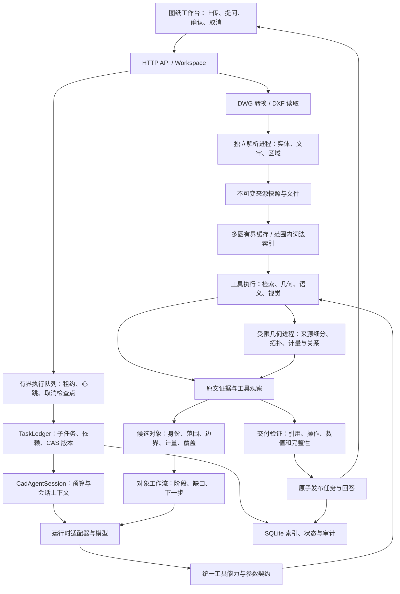

# 通用解析与模型工具问答：模块与契约

## 2026-10-19 当前实现

本节描述当前源码；后文保留最初里程碑的契约背景，其中工具数量和预算不是当前配置。当前能力以 `/api/tool-capabilities`、请求配置和运行记录为准。



本次职责拆分：

| 模块 | 当前职责 |
| --- | --- |
| `analysis/session.py` | 会话预算、来源上下文、运行时共享入口；保留兼容导出 |
| `analysis/tool_registry.py` / `tool_metadata.py` | 参数 schema、工具族、操作映射、运行时能力、重试与分页元数据 |
| `analysis/tool_execution.py` | 参数与能力校验、工具分发、响应长度约束、候选对象登记 |
| `analysis/evidence_ledger.py` / `delivery.py` | 来源证据、工具观察与最终回答校验 |
| `analysis/object_registry.py` | 候选对象身份、覆盖台账、对象工作流与跨轮版本校验 |
| `execution.py` / `analysis/tasks.py` | 执行租约、检查点、任务依赖与版本化保存 |
| `cache.py` / `analysis/retrieval.py` | 多图缓存、相同 key 合并构建、范围内 BM25 复用 |
| `geometry/compute.py` | 固定几何操作的进程隔离、有界排队、超时终止与重建 |
| `analysis/telemetry.py` | 模型请求、工具、验证、运行时阶段耗时和失败计数 |

候选对象保留来源与快照身份，名称、边界、视觉观察、计量口径和覆盖分别记录。相同名称不会自动合并成同一个房间；闭合轮廓和有效面积也不会自动成为工程确认。分页覆盖同时校验位置和唯一对象数量，读到末页不代表前页已读。界面确认单位、确认范围、继续分页会在不调用模型的情况下更新对象台账；旧单位或范围的工作流保留为 superseded。恢复任务须匹配来源、快照、单位策略和算法版本。

运行时从同一份能力清单选择工具，执行入口再次校验。视觉工具目前要求支持图片的 Responses subscription 通道，且运行时为 `responses_subscription` 或 `codex`；不支持的组合不向模型公布。回退到 Native 时保留同一个任务、已用预算、证据与调用记录，按实际回退通道重新选择工具。

单机执行采用 SQLite 事务、owner/token/lease 和任务 revision CAS，过期工作标记中断；创建 Store 本身不会把其他进程的活动任务改为失败。任务与回答、事实集合与 job 的完成状态分别在同一事务发布。工具开始和完成都有检查点；恢复由用户显式发起，不自动重放可能已执行的操作。取消是协作式的，在模型与工具边界检查；当前网络调用仍可能等到其自身超时。

解析使用独立进程；几何计算使用可复用 spawn worker，主进程负责来源校验、范围约束和保存。19 类固定白名单操作覆盖来源几何展开/细分、源图层与 ARC 描述、原生尺寸解析、纸空间视口变换与匹配、空间查询、基础量测、房间发现、文字锚点空间关联、边界生成、分区发现、轮廓扣除、组件关系与门窗分类、连接证据、内部闭合对象检查和视觉候选排序。组件、边界及连接准备不再在父进程重复调用 `native_source` 建立全图索引；条件单位判断复用同次尺寸读取的来源诊断。worker 只接收明确的数据结构；来源操作读取父进程绑定的 DXF 路径，并在计算前后核对文件标识，不接收 Store、凭据或任意函数名。

几何执行器默认仅一个计算进程、最多三个运行或等待请求、120 秒截止时间；watchdog 同时覆盖阻塞的 IPC 收发，超时终止进程且不发布迟到结果。父进程保留有界的发布前几何校验，例如最多 12 个、每个不超过 128 顶点的已选房间轮廓重叠检查。原生解析进程尚未提供逐请求硬终止机制；栅格预览、语义读取中的原生源兼容接口仍不属于这些几何 worker 操作，不能据此声称所有 CAD CPU 工作均已隔离。真实图纸验证的导入、固定工具流水线、实际模型问答分别计时，禁止用历史快照导入或旧答案冒充新 E2E。

洞口关系分析采用请求内 `source_bundle`：worker 一次建立原生索引，生成限定范围的几何、图层及 ARC 描述，房间发现、墙线细化和门窗分类复用这些纯数据。请求结束即释放局部引用；范围、单位或源文件标识不符时拒绝复用。它不增加原生索引缓存预算，也不把超出预算的大图索引长期保留。合并后的准备操作仍共享单次 120 秒期限。

关系组件分页同时限制响应长度与工具调用次数。返回 `requested_limit`、`effective_limit`、`next_offset` 和预算诊断；调用方必须使用实际 `next_offset`，不能按请求 limit 推算。Session 根据当前子任务和全局剩余调用额度调整页大小，保留原 12 次子任务预算。超大单对象或确实无法在预算内读取的范围保持显式缺口，未发送对象不计已读；`unknown` 对象和来源仍保留。

2026-10-19 同机两图指定范围单次冷应用缓存对照：几何 HTTP 阶段由 173.324 秒降至 59.389 秒、184.990 秒降至 66.729 秒。规范化完整图结果一致，12 组分页策略/页大小组合均完整交付。该结果不含重新导入及模型回答时间，也不是全图准确率或多轮性能统计；详见[本轮验证报告](../artifacts/geometry-performance-20261019/REPORT.md)。

SQLite JSON 表增加常用条件索引、数据库内过滤/分页/计数和原子更新。图纸读取、场景、原生几何和几何索引改用有界 LRU，切换模型的浅拷贝工作区共享缓存；构建发生在工作区锁之外，相同 key 的并发请求共用一次构建。容量按条目数与估算字节限制，不能等同于进程 RSS 硬上限；BM25 缓存仍需计算范围内容签名，检索没有变成常数时间。

新增可检查入口：

| 接口 | 用途 |
| --- | --- |
| `GET /api/tool-capabilities?runtime=&model_profile=` | 完整工具契约与当前通道支持情况 |
| `GET /api/execution` | 问答/抽取队列与几何执行状态 |
| `POST /api/chat-runs/{id}/cancel` / `POST /api/jobs/{id}/cancel` | 请求协作取消 |
| `GET /api/tasks/{id}/objects?offset=&limit=` | 分页读取候选对象；摘要不传输完整多边形 |
| `GET /api/tasks/{id}/object-workflows` | 对象阶段、缺口和后续操作 |

问答运行记录包含 queue wait 和 phase metrics，UI 可展开查看。部分阶段互相包含，不能直接相加；外部运行时总耗时不能当作纯模型耗时。固定合成评测分开统计完整性、正确性与耗时，包含失败尝试，参见 [评测方法与运行命令](architecture-evaluation.md)。[真实图纸评测协议](real-geometry-evaluation.md) 另行区分完整来源导入、确定性工具流水线和真实模型运行；历史代理参考集的一致性不等于独立对象准确率，工程验收仍需独立标注评测。

## 依赖边界

```text
web → HTTP app → Workspace orchestration
                       ├── cad.reader → cad.regions → immutable source artifacts
                       ├── building.masonry → evidence → contracts
                       ├── analysis.query → facts + citations
                       └── adapters.store / adapters.model
```

| 目录/模块 | 职责 | 不承担的职责 |
| --- | --- | --- |
| `contracts.py` | 版本化来源、事实、证据、覆盖和请求模型 | CAD IO、模型调用、业务门槛 |
| `cad/reader.py` | ezdxf 原生读取、实例路径、几何和文字预览 | 材料语义、优化判断 |
| `cad/regions.py` | 布局、候选图框、表格行、文字片段和邻近来源关系 | 把邻近自动当成继承 |
| `evidence.py` | 唯一原文子串校验和证据绑定 | 模型生成坐标 |
| `building/masonry.py` | 通用砌体字段、条款类别、缺失/冲突 | AR024 适用条件和替换建议 |
| `analysis/query.py` | 限定语法的确定性事实筛选和引用回复 | 开放式 agent 推理、规范审查 |
| `adapters/model.py` | 协议、超时、响应解析、安全错误消息 | 授予模型修改文件或执行代码权限 |
| `adapters/store.py` | 本地 SQLite、JSON 产物、索引、原子更新 | 执行恢复策略、生产数据库与现有调度器 |
| `service.py` | 准备图纸、任务生命周期、批次预算、缓存与快照校验 | 工程规则 |
| `app.py` / `web/` | REST 工具入口和可交互工作台 | 持有浏览器端 API 密钥 |

已有生产仓库仅作为设计和来源约束的参考。本里程碑没有直接导入其 `Above_Ground_Masonry_Materials_Optimization_Dxf.py`、生产定位器或调度器，避免把策略筛选、服务副作用和生产依赖带入新产品。保留的积累是原生文字/来源身份/缺失保守处理等实现原则；通用接口在本仓库独立实现。历史真实 DXF 用于兼容性检查和显式发起的真实模型问答验证；业务结果与 AR024 输出不参与抽取。

## 通用 REST 工具

`/api/tools` 提供工具名与路径，`/openapi.json` 提供机器可读参数；目前不是 MCP server。

| 工具 | 请求 | 返回 |
| --- | --- | --- |
| `prepare_drawing` | `POST /api/drawings`，multipart `file` | snapshot、SHA-256、layouts、frames、diagnostics |
| `search_sources` | `GET /api/drawings/{snapshot}/sources?q=&frame_id=&offset=0&limit=100` | 来源区域分页；总数 |
| `extract_facts` | `POST /api/extractions` | 异步 job；重复同版本请求复用成功/运行中任务 |
| `get_job` | `GET /api/jobs/{job}` | queued / running / completed / partial / failed |
| `query_facts` | `GET /api/fact-sets/{id}?q=&wall_role=&review_status=&frame_id=` | facts、coverage、diagnostics、manifest |
| `get_evidence` | `GET /api/fact-sets/{id}/evidence/{evidence}` | 必须属于该集合的来源证据 |
| 原始实体 | `GET /api/drawings/{snapshot}/entities/{entity}` | 实例路径、layout、原生文字、bbox、原始坐标 |
| 原图预览 | `GET /api/drawings/{snapshot}/scene` | 原始坐标线形、文字、图框和布局 |
| 事实查询 | `POST /api/chat` | 确定性回答 + 可点击引用 |
| 导出 | `GET /api/fact-sets/{id}/export` | 完整事实、证据、覆盖和运行清单 |

抽取请求：

```json
{
  "snapshot_id": "snap_…",
  "extractor_ref": "building.masonry@1",
  "mode": "local",
  "layout_ids": [],
  "frame_ids": []
}
```

空范围表示该快照中所有解析来源。显式的 layout/frame 必须属于当前快照；同时提供时取交集。当前只注册一个通用领域抽取器，下一领域通过新增抽取器与版本化 schema 扩展，而不是修改 CAD 层。

问答请求：

```json
{
  "snapshot_id": "snap_…",
  "fact_set_id": "facts_…",
  "question": "列出地上内墙材料",
  "selected_practice_id": null
}
```

支持墙体类型、地上/地下、特殊部位、材料、密度/强度/砂浆等级和信息缺失等筛选；返回原文条款而非编造摘要。选中做法时显式限定为该做法。排除、比较等未实现语法会提示限制。引用最多返回 12 条，并提示截断；完整清单可导出。做法条数不是实体墙数量。

## 数据结构与身份

`snapshot_id = hash(输入字节 SHA-256, parser version)`；同一输入重命名后复用快照。`entity_id` 绑定 snapshot、layout、INSERT 实例路径与原生 handle/虚拟实体索引。多个相同内容、同名图框或相同块定义的实例不能按文本合并。

`SourceRegion` 包含 `region_id, layout_id, frame_id, frame_name, kind, text, entity_ids, bbox, context_region_ids`。表格行中的 ` | ` 是可见列分隔符；数值抽取使用规范化视图，证据始终指向保留的来源文本和原生实体。

每个 `MasonryPractice` 包含来源发生位置 `source_occurrence_id`、`original_text`、`attributes`、`evidence_ids`、`missing_fields`、`conflicts` 与 `review_status`。属性包括：

```json
{
  "density_grade": {
    "value": "B06",
    "state": "observed",
    "evidence_ids": ["ev_…"],
    "derivation": null
  },
  "elevation_scope": {
    "value": null,
    "state": "unknown",
    "evidence_ids": [],
    "derivation": null
  }
}
```

状态为 `observed / derived / unknown / conflict`。明确标题继承必须提供标题的第二份证据；多个冲突标题不择一猜测。`statement_kind` 以显式措辞分类为 `specification / prohibition / reference / material_mention`，不能把规范引用或禁用条款解释为实际选用。

证据示例（ID 示意）：

```json
{
  "evidence_id": "ev_…",
  "snapshot_id": "snap_…",
  "region_id": "region_…",
  "layout_id": "layout_…",
  "frame_id": "frame_…",
  "quote": "地上内墙采用B06级A3.5蒸压加气混凝土砌块。",
  "text_span": [0, 24],
  "entity_ids": ["ent_…"],
  "bbox": [25, 218.2, 162.7, 221.7],
  "coordinate_space": "dxf_wcs",
  "unit": "mm",
  "precision": "entity",
  "binding_method": "exact_source_span",
  "verification_status": "source_bound"
}
```

`text_span` 是 Python Unicode 字符索引的左闭右开区间，真实值由程序计算。`precision=entity/region` 描述定位层级而非测绘精度；证据框为字体估算。浏览器将 y 轴反向显示，但 API 原始坐标不改写。当前不生成 cell 级精确定位。

`Coverage` 保留范围、来源区域数、材料候选数、产生事实的区域数、未解决与跳过区域 ID，完整性状态为 `bounded / partial / unknown`。非候选区域也记录为 skipped，可通过原文检索复核；未启用 OCR 不会算作成功识别。

`manifest` 保留输入哈希、parser / extractor / prompt 版本、范围、模式、耗时、模型 token 用量及 `policy_applied=false`。缓存包含快照、范围、模式、实现版本；模型模式还包含服务地址、模型名、协议与提示词版本。密钥不参与导出。

模型失败、超时、引用不匹配、来源为空分别记录，不生成假成功。执行管理器将租约已过期的中断 run/job 标记 failed，任务保留为 partial；其他所有者的有效租约不受新进程启动影响。失败任务可显式重试，已有成功事实集合保持可查询。

## 真实样本阅读顺序与证据映射

2026-10-14 更新：SourceRegion.parts 把拼接文字映射回原始实体；Evidence.source_parts/component_boxes 按引用区间收缩实体集合。表格备选行按单元格和基线分离，带明确列头的属性矩阵仍按行合并。章节范围由同一物理栏的编号层级限定；`application_scope`、`scope_qualifiers`、`role_parameters` 不包含规则策略。详见 [真实样本验证记录](real-sample-validation.md)。


## 里程碑二：模型与工具循环

`analysis.agent.AgentRunner` 负责有预算的模型/工具循环，`ModelGateway.chat_turn` 仅负责协议和安全错误；`Workspace` 使用独立问答线程池，避免问答等待抽取时占满抽取线程。CAD reader、通用砌体抽取和确定性查询维持原实现。

模型只有六个工具：`get_drawing_overview()`、`search_sources(query, frame_id, offset, limit)`、`read_source_context(region_id, neighbors, start)`、`extract_facts(frame_ids)`、`query_facts(query, wall_role, frame_id, offset, limit)`、`get_evidence(evidence_ids)`。所有工具隐式绑定当前 snapshot，严格校验参数，不接受模型指定文件路径、模型密钥或另一个 snapshot。`/api/tools.agent_tools` 发布完整 JSON Schema。

新增接口：

| 接口 | 用途 |
| --- | --- |
| `GET /api/drawings/{snapshot}/sources/{region}/context?neighbors=1&start=0` | 同图框、同列邻近原文及 parser context；显式返回前后顺序、各条款自己的章节关联，以及标题的关联子条款。每段返回服务器生成的证据，长段落显式分页。 |
| `POST /api/chat-runs` | `ChatRequest`，`mode=agent`；返回 202 与任务 ID。 |
| `GET /api/chat-runs/{run}` | 执行状态、实际工具摘要、token 用量、答案、错误和审计字段。 |
| `GET /api/chat-runs/{run}/evidence/{evidence}` | 只返回该次成功答案引用的证据。 |

旧 `POST /api/chat` 默认 `mode=local`；也支持同步 `mode=agent`，界面使用后台任务接口以显示进度。`parent_run_id` 只允许当前图纸的已完成问答，最多带入三轮已发布结果；追问仍须重新读取来源。

最终模型 JSON 包含 `claims[{text,state,evidence_ids}]` 与 `missing_information[]`。后端仅接受工具实际返回过的证据；observed/derived/conflict 结论必须有引用，未知引用、无依据数值或错误格式会触发最多一次纠正，仍失败则不发布。数值来源检查不是语义正确性证明，也不支持工程量计算。

最终引用保存完整 `Evidence`：snapshot、region、text_span、entity_ids、source_parts、component_boxes；坐标来自已有实体映射。邻近只是一种阅读关系，不证明适用范围；推断必须显示待核查。模型问答单独保存为 `chat_run`，不覆盖 `MasonryPractice`。没有事实集合时仍可以检索和读取原文。

预算为最多 8 轮交互（最后一轮保留给答案整理）及 1 次最终答案纠正、16 次工具调用、180 秒；单个网络请求上限 60 秒。只记录公开工具动作、验证后答案、token 用量和版本，不记录隐藏思考内容、密钥或供应商错误正文。单用户最多两个后台问答，失败和重启中断均明确记为 failed。未提供代码执行工具。
