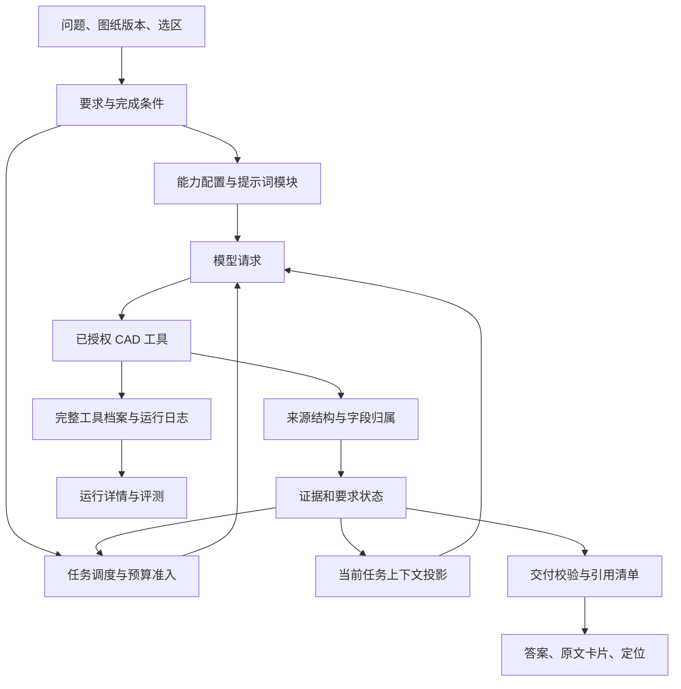

# CAD Agent 完整改进方案：来源正确性、任务调度与输入成本

日期：2026-10-23。状态：**待实施的设计与验收方案**。本文件没有宣称代码已修改、真实模型已复测或成本已经下降。

实施记录：六阶段代码与本地迁移已落地，外墙三次前后订阅对照及全量回归已完成；固定20题综合验证结果以[实施报告](../artifacts/cad-improvement-20261023/report.md)为准。下文保留原设计目标，不能把目标值视为实测结论。

方案依据：[五项目研究汇总](/Users/vigorchen/Documents/WorkExplore/cad_opt_agent/artifacts/agent-patterns-research-20261023/README.md)、[外墙问题运行审计](/Users/vigorchen/Documents/WorkExplore/cad_opt_agent/artifacts/exterior-wall-query-audit-20261023/report.md)、五份固定版本源码研究，以及当前 CAD Agent 实现。允许在收益明确时重构相关模块；不要求迁移到任何一个外部 Agent 框架。

## 1. 决策与目标

实施一套贯穿“要求 → 来源 → 工具决策 → 模型上下文 → 交付”的统一契约，而不是独立叠加更多提示词和防循环补丁。

优先级为：**来源与引用正确 → 要求覆盖完整 → 有效停止与恢复 → 降低请求输入与等待 → 可持续评测**。外墙问题的直接错误应先独立修复，不能等待大重构结束。

最终希望达到以下行为：

1. “帮我找下外墙做法”先定位做法标题、图框和表格；在能够确认边界时直接返回编号、适用范围与对应做法内容。多个做法可以按范围列出，无须一律反问用户。
2. 内墙、楼地面等调查材料不能因为“读过”“更长”而进入外墙答案的原文证据。
3. 同一归属问题未解决时，Agent 改用表格或局部图像检查；不靠读取更多混杂段落刷新进展。
4. 简单查阅只携带必要工具和规则；复杂几何仍有完整能力与充分预算。
5. 用户可以查到结论所用原文，也可以在运行详情中检查未采用材料、失败原因和实际消耗。
6. 每次变更都能用固定图纸、问题、选区和版本比较质量与成本，避免把漏答当作节省。

保持以下产品边界：CAD 图纸事实分析；现有订阅 harness；无付费 API 自动回退；不自动切换模型或升级推理档；`source_read_batching=false` 为默认，只有显式开启才批读。来源归属确认不等于建筑对象身份、工程适用性或合规结论确认。

## 2. 基线与重构范围

### 2.1 本次外墙问题的已知事实

运行 `chat_6462af9851a2417fa9a255c22c784c72` 使用 GPT-6.1 Sol / low、`responses_subscription`，图纸为 `建筑_通用图_J00~TJ10.dwg`。

| 指标 | 观测值 | 改进含义 |
| --- | ---: | --- |
| 模型调用 | 11 次 | 没有失败重试；主要是查阅路径绕路 |
| 查阅工具 | 10 次，另有一次交付调用 | 搜索分页、归属失败后续页、逐个读标题 |
| 输入 / 输出 token | 271,974 / 834 | 成本集中在重复输入，不是答案太长 |
| 系统指令输入 | 45,606，占输入 16.77% | 每轮 4,146；需要按任务拆分 |
| 工具定义输入 | 103,433，占输入 38.03% | 每轮 24 个工具、9,403 tokens |
| 其余输入 | 122,935，占输入 45.20% | 历史、工具输出、问题和任务状态等 |
| 耗时 / 模型等待 | 101.164 / 98.993 秒 | 减少无效模型请求比优化本地毫秒级执行更重要 |
| 缓存输入 | 服务端报告 0 | 缓存原因未确定，不能预先计算缓存收益 |
| 最终结果 | 四个标题，分项 partial | 运行结束不等于完整做法交付 |
| 最终引用 | 模型选择 4 条，服务端另加 12 条 | 自动追加是无关原文进入答案的直接路径 |

上述 token 分项来自该次服务端 `usage.attribution.request_fields`。其他运行若没有该字段，只能标记本地估算，不能复制本次占比作为通用比例。

来源侧同时存在标题格式漏识别、过宽列归组和段落跨列拼接。两次 `read_assembly` 的 `source_binding` 均为空，并返回 `ROW_ENVELOPE_UNRESOLVED`。只精简提示词无法修复这些问题。

### 2.2 复用与替换清单

| 当前机制 | 处理方式 | 新增或重构部分 |
| --- | --- | --- |
| TaskLedger、typed requirements、coverage、操作回执 | 保留存储与领域校验 | 统一要求状态和有效进展事件，清理重复判定 |
| 精确 source span、引用注册、字段级证据、数值/计算校验 | 保留并强化 | 统一来源归属、结论使用关系与最终引用集合 |
| `append_source_excerpts` 对 partial 按长度补原文 | 取消其自动进入答案的行为 | 已读材料由运行详情承接 |
| 做法标题、表格、区域解析 | 允许较大重构 | 标题规范化视图、细粒度阅读列、可解释来源边界 |
| `focus.py` 大提示词与粗工具家族 | 分阶段替换 | 提示词模块与能力配置共同选取 |
| StableTools 的稳定排序、按需追加 | 保留原则 | 更小初始目录、缺口驱动的具体工具扩展 |
| 整体 payload 预算预检、最终回答预留 | 保留 | 按任务类别配置、末段收敛与实际余量通知 |
| failure guard、stalled、progress signature | 合并判定入口 | 不再让无关新 evidence/items 重置停滞 |
| evidence archive、回读授权与哈希、payload projection | 复用 | 原子化上下文投影与单调淘汰策略 |
| 运行日志、逐轮请求哈希、用量与 UI inspector | 复用 | 关联策略/提示词版本、有效进展和固定评测项 |

当前 HEAD 为 `650e105dd82a1a52c55e187081e71420c21f6bf2`，工作区已有未提交修改，包含运行日志与 inspector。实施基线必须包含这些修改的文件哈希和 diff，不能只记录 HEAD，也不能为建立干净基线而丢弃它们。

部分文档已落后于实现：例如 `docs/task-orchestration.md` 写分项五次调用，当前 `scheduling.py` 为 12 次及有进展时额外 4 次。迁移时以实际代码和运行记录为准，并同步更新文档。

## 3. 五项目方案的采用矩阵

外部实现提供机制参考，不提供 CAD 语义正确性的现成保证。

| 来源 | 有益机制 | CAD 中的采用方式 | 不能照搬的部分 |
| --- | --- | --- | --- |
| Onlook | 按模式真实选择工具 | 做法、表格、空间等小型能力配置，发送前裁剪 schema | 它的每次 stream 步数不等于任务总上限 |
| Onlook | 短系统提示、长说明按需加载 | 常驻共同约束；已知任务直接加载专题，低频专题按需加载 | 不为获取已知说明平白新增一轮工具请求 |
| Onlook | 历史文件正文与 UI 原件分离 | 模型工作集和完整证据档案分离；保留来源身份 | 上游部分身份键只用路径，CAD 要包含快照、跨度和版本 |
| CopilotKit | 工具注册与实际曝光分离 | 注册表保持完整，请求只发送允许且需要的定义 | 前端禁用不替代服务端执行授权 |
| CopilotKit | skills 目录与正文分离 | 小型能力目录和按需规则模块，不引入远程 skills 服务依赖 | 旧版 token limiter 不作为新运行时基础 |
| CopilotKit | 工具后可关闭模型跟进 | 原文展开、定位、下载和已有结果展示直接由程序完成 | CAD 的 `finish_analysis` 已直接返回，不能重复计算这项收益 |
| CopilotKit Keel 示例 | 根据 docId/sectionId 回解原文 | 根据本地 evidence/record ID 回解精确原文、标题和位置 | ID 存在不等于来源支持结论 |
| LibreChat | 延迟工具发现、本地检索 | 对低频工具 opt-in，优先用现有 `request_toolset` 扩展为细粒度发现 | 不一次性把所有工具都改成需要发现 |
| LibreChat | 末段轮次提示、预留成稿 | 在既有预算预检上提供剩余可探索请求、停止条件和缺口 | 不照搬其图节点数与模型轮次的换算常数 |
| LibreChat | 模型锚点与 UI 引用共享选择 | 一个 EvidenceSelection 规则，同时约束可引用集合与最终显示 | 相似度 0.45、文件数量等阈值不是 CAD 归属置信度 |
| LibreChat / SDK 基线 | fading 逐步收紧、持久状态 | 历史进入摘要/档案后不自动全量回流；显式回读只临时恢复 | 不按年龄删除尚未完成的层次、单位和冲突依据 |
| OpenHands / SDK | 重复失败提示、STUCK、停止原因 | 工具参数与目标规范化去重；一次策略提示后有界恢复 | 不按 thought 文本判重；不使用 500 轮默认值 |
| OpenHands / SDK | 调用与返回、批次原子性 | 协议原子性加 CAD 证据原子性后再压缩 | 240 事件阈值不是累计 token 预算 |
| OpenHands / SDK | 提示词 section registry | 条件模块、确定顺序、静态/动态分离 | 不移植编程代理长提示词、默认 critic 或额外总结模型 |
| Langfuse | generation/tool/run 分层记录 | 每次实际模型请求单独计量；工具挂 call ID；根级汇总不重复计数 | 遥测去重和流事件合并不减少模型输入 |
| Langfuse | prompt version、数据项和实验关联 | 本地版本清单、固定数据集、同题对比和质量门槛 | 不依赖其需要 provider API key 的实验执行器 |
| 多项目 | 稳定前缀和 provider 缓存 | 复用现有哈希与 usage 进行传输诊断 | 不把 Claude cache 标记直接应用于 Sol 订阅 |

五份详细报告固定了源码提交及路径：[Onlook](/Users/vigorchen/Documents/WorkExplore/cad_opt_agent/artifacts/agent-patterns-research-20261023/onlook.md)、[CopilotKit](/Users/vigorchen/Documents/WorkExplore/cad_opt_agent/artifacts/agent-patterns-research-20261023/copilotkit.md)、[OpenHands](/Users/vigorchen/Documents/WorkExplore/cad_opt_agent/artifacts/agent-patterns-research-20261023/openhands.md)、[LibreChat](/Users/vigorchen/Documents/WorkExplore/cad_opt_agent/artifacts/agent-patterns-research-20261023/librechat.md)、[Langfuse](/Users/vigorchen/Documents/WorkExplore/cad_opt_agent/artifacts/agent-patterns-research-20261023/langfuse.md)。LibreChat SDK 研究仅确认 v4.0.6 基线，不声称确认其主仓库实际安装版本。

## 4. 目标架构与统一数据契约

不增加通用工作流服务器或第二套数据库。先在现有 Python 模块内实现契约与适配层，只有职责稳定后才拆文件。

### 4.1 RequirementSpec：明确要交付什么

在现有 requirement/coverage 数据上增加或规范：`requirement_id`、`intent`、`object`、`requested_fields`、`scope_constraints`、`completion_conditions`、`dependencies`、`unresolved_gaps`。

做法查阅区分三种意图：

- `locate`：用户明确只找位置/目录，完成条件是准确的标题、位置和来源入口。
- `describe`：一般“找下某做法”默认积极读取可确认的做法内容，提供编号、适用范围和已绑定层次；只找到入口应明示结果范围。
- `enumerate_all`：用户要求全部、所有类型、完整层次，必须检查候选集合和分页覆盖，不得以首个命中结束。

不要用一个关键词硬判全部任务。结合原句、当前图纸和已有任务上下文；可由模型在已有调用中校正，校正不能偷偷缩小原始要求。用户未限定具体外墙时先按图框/表格列出已知做法；只有不同选择会实质改变所需答案且无法并列表达时才请求补充。

### 4.2 EvidenceRef、SourceBinding、ClaimUse：分开三个问题

| 契约 | 关键内容 | 能证明什么 |
| --- | --- | --- |
| EvidenceRef | 快照与源 hash、region/entity IDs、精确 text span、原文、内容 hash、读取回执 | 原文存在且本任务确实读取了该跨度 |
| SourceBinding | 记录/章节 ID、版本、标题跨度、表头/行列/边界依据、字段跨度、适用范围原文、缺口 | 该值在来源结构中属于哪条记录、哪个字段 |
| ClaimUse | claim/requirement/field ID、所用 EvidenceRefs、支持角色、适用范围、校验结果 | 答案采用哪些来源支持哪项表述 |

证据生命周期不是一个含糊的 `valid=true`。至少独立记录：检索候选、已读、来源归属状态、结论使用状态、工程适用性状态。相同原文可以支持“标题写了外墙1”，却不足以支持“这些地砖层属于外墙1”。

`source_bound` 只表示有可检查的来源结构关系，不表示任意模型解释都正确。程序校验覆盖存在性、范围、跨度、单位、字段关系和算式；自由语义仍可能出错，必须在评测中检查。视觉候选、词面相似和模型自报 confidence 不升级为工程确认。

### 4.3 ProgressDelta：统一有效进展

所有工具执行后生成同一份进展增量，由调度、预算、停滞检测和日志共同消费：

- `verified_progress`：目标字段新增合法来源绑定、缺口解除、完整页覆盖增加、有效测量/计算回执成立。
- `candidate_progress`：发现新的相关标题/候选记录或确实未检索的范围。允许有限探索，不等价于已完成。
- `diagnostic_progress`：发现列冲突、解析失败、缺少表头等新诊断。允许切换策略，不无限续命。
- `no_progress`：相同候选改排序、相同内容换 ID、无关来源、重复回读、工具成功但目标状态不变。

进展按要求与目标记录归属，不让别的分项新读到证据解除当前分项停滞。计算使用稳定目标和字段状态差异，不使用自然语言 thought。发现真实冲突可以记录进展，同时维持 `conflict`，不能被计成“答案更完整”。

### 4.4 DeliveryManifest：最终答案的唯一发布输入

包括 `claims`、`claim_uses`、`selected_evidence_ids`、`requirement_outcomes`、`unresolved_gaps`、`completion_scope`、`validation_version`。最终正文编号、来源卡、导出与定位全部从该清单生成，不再在校验后追加任意来源。

发布校验、任务最终状态和发布事件使用同一版 manifest；至少通过版本比较/幂等保存避免“已标完成但发布失败”的分叉。外部运行成功、业务交付完成和质量验收通过分别记录。

## 5. 来源解析与查阅路径重构

### 5.1 标题与检索

将做法标题识别抽成共用解析器，供搜索排序、目录、章节截断与做法读取调用，避免四套正则逐渐漂移。支持实际出现的冒号、长横线、全角编号、括号、重复类别前缀和换行形式，例如：

- `外墙：外墙1——有保温`
- `外墙1——有保温`
- `外墙1（有保温）`

建立用于匹配的规范化文本和到原文跨度的映射；**不改写引用原文**。标题解析输出类别、编号、名称、匹配依据和原始跨度，不因匹配成功就确认下方所有文字的归属。

搜索先约束图纸/图框/已知表格范围，再综合精确编号、类别、标题和字段匹配排序；稳定 ID 仅作最终并列顺序。分数解释为检索排序依据，不作为证据置信度。中文分词、别名和材料词权重要通过本地样例校准，不照搬 Keel 的英文权重。

首屏返回去重的标题候选、位置、范围、总数/分页和可执行读取参数。搜索摘要不能自动获得已读原文资格。相同编号出现在不同图框时保留独立候选，不用编号合并；同一全文内不同跨度也不按文件 URL 去重。

### 5.2 阅读列、段落与表格

重点修改 `cad_agent/cad/regions.py` 的列划分和 `reading_lines`/段落拼接：

1. 优先使用真实表格竖线、单元格和行边界；没有足够网格时，结合文字 bbox、横向间隔、基线、缩进和局部标题检测候选阅读列。
2. 宽外框不再天然等于一个阅读列。列应限定在当前布局/图框/局部纵向带，避免整页不同区域共用一个粗 `column_key`。
3. 对跨列 region 使用 `parts`/实体级来源拆分；不能仅修下游排序而留下已拼在一起的原文。
4. 标题终止边界需要同级标题、表格行界、明确章节边界等依据。缺边界或存在竞争边界时保留候选，禁止无限延伸到整列。
5. 旋转文本、无框表、多层表头、跨页续表和引用详图使用对应恢复路径；不能用一个近邻算法兜底全部结构。

阈值基于局部文字尺寸与几何比例，保留方法版本及边界证据。新增解析器版本使索引、来源绑定与工具缓存失效；旧任务继续读取旧版本档案，不在原 ID 下静默替换内容。

### 5.3 read_assembly 的输出与恢复

将结果明确分为：可绑定记录、仅定位到标题、归属未解析、需要引用原文、分页未完、结构冲突。`same_column_neighbors` 可以返回调查候选，不能作为完整做法的层次集合，也不能自动产生“下一页做法”信号。

当存在可靠来源记录时，保持 `record_id/version` 稳定，并返回标题、字段/层次、边界证据、适用范围、层序依据和完整性。编号顺序不自动等于由内向外施工顺序；没有明确单位的厚度保留单位未知。

当返回 `ROW_ENVELOPE_UNRESOLVED` 时，提供结构化缺口与下一步候选：

1. 已定位表格：优先 `read_table` / `read_table_semantics` 补表头和单元格归属。
2. 无可靠表格：局部 `render_region` / `inspect_region` 检查标题与分栏，再绑定可检查的文字跨度；图像仅提供候选时仍保留未确认。
3. 显式“详见某图/某做法”：沿引用定位，核对版本和范围；记录循环与深度，不能无限追图。
4. 同一缺口已经尝试可用路径仍未解决：输出已知入口和准确的归属缺口，不继续分页同一混杂集合。

通过一次来源工具返回一个已请求的完整逻辑记录，属于修复工具契约；不等于偷偷开启多目标批读。多记录 `batch_read_sources` 仍受显式开关限制。用户主动展开已有原文、翻页已保存档案和定位图纸不需要模型参与。

## 6. 交付与原文展示

第一项独立修复是移除 `append_source_excerpts` 在 partial 时自动扩充最终 `citations`/正文的路径，保留调查材料在任务档案和 inspector 中的可访问性。

新增统一 EvidenceSelection 入口，复用现有证据注册与字段检查：

1. 按任务、快照、源版本和已读跨度验证引用身份。
2. 按要求和 ClaimUse 验证用途：标题引用只支持定位，层次字段需要对应记录/字段关系。
3. 模型可引用候选目录和最终 UI 使用同一规则；最终清单是其中被答案明确采用、通过校验的子集。
4. 同一来源可支持多个字段，但每个使用关系单独记录；去重键包含来源版本与跨度，不是只用 quote 或文件名。
5. 最终引用清单冻结后，不允许后处理追加未经此流程的材料。

答案主视图展示“结论/做法内容 → 对应来源卡”。卡片由服务器按 ID 回解原文、图纸、图框/表格、字段位置、已知范围和读取完整性；模型不负责重新抄写长原文。长内容可折叠，但用户能够展开全部已选来源，不能靠 UI 截短掩盖未读或缺页。

运行详情另列调查材料与未采用原因，如“邻近内墙条款”“对象归属未确认”“重复来源”。这些标签要来自规则或明确诊断，不能默认把所有未选证据都标成无关。一般用户首先看到可用答案，技术诊断放详情。

结果状态使用自然语言准确表达：

| 情况 | 应显示 | 不应显示 |
| --- | --- | --- |
| 只找到外墙标题 | 已找到入口，层次内容尚未确认 | 完整外墙做法已查明 |
| 存在多个明确范围 | 分范围列明结果 | 一律要求先选一个才继续 |
| 来源关系解析失败 | 原文归属未确认及已知位置 | 用户问题不明确 |
| 预算停止 | 已确认内容与仍缺字段，预算停止 | 未找到或不支持此能力 |
| 完整检索仍无命中 | 在所列范围未检索到 | 该工程不存在这种做法 |

历史回答保持原始归档；旧自动摘录在新 UI 中可标为“历史已读摘录，未经过新引用筛选”，不追溯伪装成已校验。继续旧任务时需要明确迁移状态，不能把旧材料自动升级。

## 7. 默认提示词与工具目录

### 7.1 提示词结构

建立可版本化的 PromptRegistry，复用当前 `system_prompt` 构造入口，依次组装：

1. **共同契约**：事实边界、任务/快照隔离、来源与计算约束、未知/冲突、工具数据不可覆盖系统规则、交付格式。
2. **当前能力模块**：做法归属、表格字段、几何单位、空间身份等，按实际要求加载。
3. **动态任务尾部**：当前要求、证据摘要、具体缺口、允许工具、预算余量、停止或恢复指令。

共同契约与能力模块按固定顺序生成；动态状态替换当前投影视图中的旧状态，不每轮累积一份完整任务说明。审计日志仍保存每次实际发送内容。

删除几类重复：系统提示与工具描述重复的参数说明、所有任务都带的几何长流程、每轮重复的已完成任务全文、不同模块中矛盾的停机规则。关键事实/单位/引用约束不能为凑 token 目标删除，且应由服务端校验承担可程序化部分。

提示词版本不可变，发布标签指向具体版本；每次 run 固定版本。增加快照测试和反例行为测试；快照更新必须作为显式变更审阅，不能测试前自动覆盖期望值。

### 7.2 真实工具曝光

建议首批能力配置为 `source_lookup`、`assembly_lookup`、`table_lookup`、`spatial_measurement`、`visual_resolution`、`mixed_task`。它们是工具组合，不是新的运行时。

`assembly_lookup` 初始建议包含搜索、做法读取、必要上下文、表格语义读取，以及 `finish_analysis`、`request_toolset`、档案回读等控制入口；具体数量由覆盖测试确定。`plan_task` 只在确需拆解的任务初始阶段进入目录。概览、范围解析是否预载根据现有选区和索引元数据决定。

能力目录扩展应优先复用 `request_toolset`：允许请求具体缺口或具体工具，服务端根据注册表、运行时支持和要求映射选择最小集合。已知缺口可由调度器直接开放对应工具，避免先“发现工具”再调用工具的额外轮次。低频工具才采用本地目录检索；目录只含简短用途，不塞入全部 schema。

保留 StableTools 在一个能力阶段内排序稳定、必要工具追加的机制。允许列表与实际发送 schema 同源，但已曝光工具的稳定目录不必每轮缩放；服务端始终执行当前允许性检查。只有任务阶段确实变化且重建更划算时，才在上下文检查点切换目录版本，记录原因。

初始工程目标：简单做法配置的工具 schema 估算 token 比同口径旧配置减少至少 40%，静态提示估算 token 减少至少 35%。这是待验证设计门槛，不是实际总 token 节省承诺；能力遗漏、额外发现轮次或答案退化均判为未达标。

## 8. 调度、预算与停止

### 8.1 用一个决策入口协调现有机制

在 `scheduling.py` 中统一产生下一步决策，消费 RequirementSpec、ProgressDelta、gap routing 和既有预算预检结果。`tasks.py` 负责记录，`failure_guard.py` 负责具体错误/重复诊断，`efficiency.py` 不再另用“新 evidence 数”决定任务是否继续。

调度状态为定位、读取、归属恢复、交付检查、终止。每次决策记录目标要求、预期弥补的缺口、建议工具、预计输入代价和停止理由。模型可以选择允许的下一步，但不能更改服务端验收条件。

候选进展采用阶段性配额：新的标题和新范围允许继续定位；只有重复材料则收束。归属失败必须切换有依据的读取路径。相同目标、相同方法、相同缺口重复时先一次明确反馈，再阻断该动作；独立要求继续执行。真正扩大范围、读取未完成页或补齐表头不应被误判为重复。

复用已有有界 gap recovery，并把计划修改、能力扩展、工具调用、provider 请求、受控重试、成稿与纠错都纳入同一 task budget 账本。恢复任务创建新 run，保留历史用量和本次预算分配；不得通过自动重启 run 无限续费。

### 8.2 预算分层与初始校准值

现有 schema-inclusive preflight、未知用量预留、最终回答预留和错误重试规则继续使用。任务预算和单次上下文上限分别控制：输入还放得下，不代表继续读值得；总预算还有余量，不代表来源足够交付。

以下仅为离线/影子模式起始参数，不直接作为生产新默认：

| 项目 | 简单来源查阅候选配置 | 复杂任务 |
| --- | --- | --- |
| 探索软预算 / 总请求准入预算 | 120k / 220k tokens | 先保持当前标准/深度档 |
| 成稿及至多一次纠错预留 | 50k tokens，且依实际 payload 复核 | 保持现有预留策略 |
| 模型请求软阈值 / 上限 | 6 / 10 次，包含成稿与纠错 | 先保持当前档位 |
| 工具调用上限 | 12，受字段进展与总预算共同约束 | 保持现有总预算约束 |
| 单次输入投影检查点 | 估算达到 24k tokens 时评估 | 依任务与模型上限评估 |

影子模式记录“若执行新策略会在何处收束”，但不因此改变旧运行结果。选择新默认前，检查真实复杂度和质量曲线；简单查阅一旦发现跨图引用、大量做法或复杂归属，可在同一 run 内有理由地提升任务档，记录原因与新上限。预算不能自动改模型、改订阅通道或开启批读。

末段提示由实际剩余预算推导，至少区分已报告用量、未知请求预留、最终回答预留。剩余少量探索机会时说明“还缺什么、应补哪项、哪些已确认”；没有预算执行恢复时转入部分交付。不是固定再写三段催促，而是当前状态的一次替换。

到最终阶段通过 `tool_choice` 和服务端规则限制继续探索；若既有 `finish_analysis` 已校验成功，直接返回。失败纠错仍须通过预算准入，不能在上限外追加免费轮次。

### 8.3 结束原因

建议标准化 `complete`、`partial_source_binding`、`partial_missing_source`、`partial_budget`、`waiting_user_scope`、`blocked_capability`、`stuck`、`cancelled`、`provider_error`，并保留原始诊断。与现有任务状态通过兼容映射对接，不立即替换所有 API 枚举。

`complete` 根据用户要求的完成条件判定；定位任务可以完整完成，完整做法任务只交标题不能完成。预算触顶、工具成功、模型主动结束和 run completed 均不能单独决定业务完成。

## 9. 上下文投影、归档与缓存

### 9.1 三种视图，共用一个事实来源

| 视图 | 内容 | 规则 |
| --- | --- | --- |
| 完整档案 | 原始工具结果、原文、几何、请求与公开响应 | 复用 Store、哈希、授权与现有日志 |
| 模型工作集 | 当前要求、必要证据、缺口、当前操作与少量历史 | 按任务用途投影，显式记录省略项 |
| 用户交付 | manifest 选中引用及可展开的完整原文 | UI 折叠不改变证据资格，也不冒称输入变小 |

优先使用确定性投影，不额外调用模型总结。必须保留的两类原子：

- 协议原子：tool call 和 result 配对；同一响应内相关调用不拆成非法协议历史。
- CAD 证据原子：身份标题、字段值跨度、必要表头/边界、单位、适用范围、替代条件、冲突和完整性。一个原子可以通过引用关联多个片段，不要求把整张图放进每轮。

不能直接切断原文、JSON 参数、层次序列或计算依据。大单项超预算时分页或返回明确缺口，不能先丢掉再宣称已读全。档案回读只恢复可见内容，不新增 source binding、语义确认或测量信用。

### 9.2 受控压缩与回读

将当前普通历史保留和 64k 检查点扩展为按任务配置的 ContextProjector。触发条件包括预估输入、历史重复比例和阶段变化；只在确实减少 payload 且必要原子可保留时重建。

已完成搜索可缩成查询、范围、命中记录、已访问页、排除原因和档案 ID；调查材料移出工作集。未完成要求所需来源和最后一组完整调用/反馈优先保留。视觉、代词追问和活动几何须通过专项回归后才能启用激进投影。

投影等级在同一上下文阶段内只收紧；显式回读暂时加入必要原子，不因为重新组装 session 又恢复整段旧历史。将视图/要求、快照与源 hash、解析版本、记录和跨度共同纳入缓存键，防止 summary 遮蔽 full、不同图框互相串用。

`result_view=full` 保持可用，但仍受总预算、返回长度和来源资格规则约束；它表示本次工具结果不投影，不等于原始 CAD 或该做法已完整核验。候选行、未读标记和冲突不得随压缩消失。

### 9.3 缓存诊断

先分析已有 instructions/tools/prefix hash 与实际发送字段、路由、用量，不先增加未经支持的缓存参数。记录 cache 字段缺失为 unknown，明确 0 与未知的差别。缓存未命中时能力裁剪仍应独立成立。

区分模板缓存、工具结果缓存、provider 输入缓存。稳定前缀能改善缓存条件，不保证该订阅路径命中；缓存输入仍计入总输入 token，不据此推算美元或账号剩余额度。只在同题重复实测后报告缓存对耗时和未缓存输入的影响。

## 10. 日志、提示词版本与评测闭环

扩展现有 `run_journal.py`、`model_requests` 与 inspector，而不建立平行的 tracing 系统。

每次 run 关联：源图 hash/快照、原始问题、选区/范围、代码和 dirty manifest、提示词版本、能力配置与 schema hash、解析器/投影器/调度策略版本、模型/effort/订阅路由、批读开关、评测数据项版本。

每次实际 provider 请求分别记录 generation ID、逻辑轮次、重试序号、父级调用、输入/输出/缓存用量与缺失状态、分项归因来源、等待时间和结束原因。根 run 汇总叶子 generation；不能既加根总数又加子数。供应方不透明的托管内部轮次明确标“不可见”。

每次工具记录目标要求、实际参数、工具与来源错误、ProgressDelta、工作集大小变化、选中/排除证据原因和后续路径。预算拒绝未发送请求只记决策事件，不计为实际模型请求。

本地实验清单采用 Langfuse 的关联方式：固定 dataset item/version → prompt/policy release → run/generation → 校验与人工评分 → 汇总。可日后添加 Langfuse 导出适配器，但不是实施前提；导出默认关闭，不把图纸原文和账号信息自动传到第三方。真实模型执行继续使用订阅 harness。

评测报表至少同时展示质量、完成范围、输入组成、总输入/输出、未缓存输入、实际请求数、p50/p95 延迟、重复/无进展调用、部分交付原因和失败率。小样本只给逐次值与中位数，不拿三次运行估计有意义的 p95。

## 11. 六阶段实施路线与退出条件

阶段是可独立审阅的变更批次，不要求一次性切换全部系统。模块名中“新增”均为建议，不是现有文件。

| 阶段 | 交付内容与主要文件 | 依赖 | 退出条件 |
| --- | --- | --- | --- |
| P0：固定基线与交付止错 | 固定外墙 fixture；`delivery.py`、`session.py`、`web/app.js`、inspector；停止自动补入调查材料 | 无 | 原 12 条追加可复现且新路径不会追加；有效 claim 引用、定位和历史查看不丢失 |
| P1：来源结构修复 | `cad/regions.py`、`analysis/assembly.py`、`general.py`、`semantics/tables.py`；共用标题解析与版本化绑定 | P0 fixture | 真实标题召回；跨列负例不串入；完整层次/引用缺口可检查；同题及其他做法回归 |
| P2：统一要求、证据与进展 | `coverage.py`、`typed_requirements.py`、`tasks.py`、`scheduling.py`、`gap_routing.py`、`failure_guard.py`、`delivery.py`；可新增契约/选择模块 | P1 契约稳定 | 无关新证据不刷新有效进展；缺口换策略；最终引用清单唯一；状态可恢复 |
| P3：提示词与能力目录 | `focus.py`、`tool_metadata.py`、`tool_registry.py`、`stable_prefix.py`、`session.py`；新增 PromptRegistry/能力配置 | P2 接口 | schema/提示输入目标通过；必需工具可到达；跨 runtime 校验不分叉；质量无退化 |
| P4：任务预算与上下文 | `budget_policy.py`、`responses_subscription.py`、`efficiency.py`、`evidence_store.py`、`payload_projection.py`、相关 runtime 适配层 | P2、P3 | 影子策略校准；调用配对、证据原子、恢复及预算预留通过；真实输入减少 |
| P5：同题验收与发布 | 现有 benchmark/replay 脚本、日志/inspector、版本清单、文档 | 各阶段 | 固定集质量门槛通过；成本与延迟可比较；小范围启用后再默认发布 |

P0 的引用修复应保持独立，后续调度或投影回退不能把自动补入无关原文重新打开。P1/P2 允许重构而非继续堆条件；P3/P4 优先通过适配层替换，保持公共 API 和工具参数的兼容窗口。

实施过程中及时同步 `docs/task-orchestration.md`、`focused-delivery.md`、`runtime-budgets.md`、`agent-efficiency.md`、`task-payload-projection.md`、`run-inspector.md`；避免代码已换策略而文档仍描述旧阈值。

## 12. 验证设计与量化验收

### 12.1 固定数据与反例

先从已审计外墙运行提取最小必要来源 fixture，保留文字实体、局部表线、坐标、原始跨度和所属图框。完整敏感图纸继续留在本地，报告链接不暴露凭据。

| 测试族 | 必须覆盖的情况 |
| --- | --- |
| 标题 | 三种真实格式、全角编号、重复前缀、断行、正文提到外墙但不是标题 |
| 结构 | 外墙/内墙/楼地面并排；同高文本；宽外框；断线；无框表；合并单元格；跨列 region |
| 归属 | 同编号不同图框；多级表头；材料词相同但对象不同；层序未知；适用范围在另一个单元格 |
| 完整性 | 多页层次、长条款、替代项、引用其他做法、循环引用、只读最后一页、搜索命中未原文读取 |
| 交付 | partial 不自动加材料；伪造/外来 ID；标题支持目录却不支持材料层；有效共享引用；发布失败重试 |
| 调度 | 无关新 ID、重复内容换序、交替循环、表格恢复成功、无能力恢复、一个分项停滞不影响其他项 |
| 上下文 | 工具配对、单位/否定/例外/冲突保留、summary/full 缓存隔离、回读不增加证据信用 |
| 运行 | 超时、取消、重启、真实重试计量、预算不足成稿、历史任务恢复、默认批读关闭 |

在相关现有测试上扩展，例如 `test_remediation_assembly.py`、`test_b02_assembly_binding.py`、`test_b04_bound_coverage.py`、`test_remaining_source_isolation.py`、`test_focus_delivery.py`、`test_runtime_policy_v1.py`、`test_source_batching_option.py` 和 inspector 测试。测试检查可观察行为与错误反例，不只验证新增函数返回了自己生成的值。

### 12.2 分层验证

1. **确定性单元/契约测试**：标题、列、跨度、字段、选择器、预算和状态转换。
2. **固定工具回放**：重放真实外墙工具链，检查旧错误可复现、新规则阻断或换路。该结果不代表模型会选择正确路径。
3. **本地产品集成与 UI 检查**：真实 CAD 工具、持久化和引用定位；可用 scripted fixture 构造失败/恢复，不算真实模型 E2E。
4. **订阅真实模型定向 E2E**：相同图纸、问题、范围、模型与 effort，比较基线和各阶段新版本。每个重点用例至少 3 次，公开全部结果，不挑最好一次。
5. **固定综合集与人工语义核查**：包括既有 20 题以及新增外墙负例；保留每题实际选区，不允许给新版本偷偷补选区。审查引用是否真的支持字段，不能只看 URL/ID 存在。

先跑受影响的测试；来源解析、调度、通用交付等广泛变化完成后跑完整 Python 与相关 Node 回归。真实模型实验单独记录，不将本地通过混称正式验收。不默认增加 LLM judge 或第二个 critic；人工标注与确定性校验优先，未来引入 judge 也单列其成本与误差。

### 12.3 发布门槛

**硬性质量门槛：**

- 指定负例集里，跨对象/跨图框/跨任务误归属、未经选择的自动引用和伪造原文均为 0。
- 所有最终引用均能按源版本回解精确跨度，且有明确 ClaimUse；存在性通过不能代替人工语义支持审查。
- 外墙问题必须提供已确认的对应内容，或者准确解释来源缺口；仅删掉错误摘录却仍交付不完整标题，不算整个改进完成。
- “全部/完整”任务的分页、字段与范围覆盖不得降低；未解决问题不伪装为 completed。
- 综合集不得新增关键质量失败；整体质量不低于同配置基线。任何被压缩掉的单位、否定、替代条款造成的错答阻止发布。

**性能目标，须在等质量前提下验证：**

- 固定外墙问题总输入 token 的重复试验中位数争取较本次历史 271,974 降低至少 50%，即约 136k 以下；历史单次仅作参考，正式比较还需冻结旧策略的新样本。
- 同题典型路径争取 4–6 次模型请求，而非 11 次；复杂归属恢复可以超过此值，不能为达轮次目标提前截断。
- 更广的简单查阅集合争取输入中位数下降至少 30%；模型等待改善单独测量，不承诺与 token 同比例。
- 真实调用变少、工具目录变小和历史投影分别做消融对照，区分谁贡献了收益；报告未达目标的用例及质量变化。

性能目标未实现时继续调整路径、工具集合与投影；不能放松质量门槛补足“节省”。缓存收益、输出长度变化、provider 波动与代码优化的影响分开呈现。

## 13. 迁移、兼容与回退

1. 新运行固定 `execution_policy_version`，其下引用提示词、能力配置、解析器、投影器和交付规则版本。避免堆出大量可任意混用、未经测试的布尔开关；实验组合使用明确配置 ID。
2. 先给存储增加可选字段与读取默认值，再切新写入；旧 API 保留兼容映射。旧任务若没有来源绑定证据，保留 unknown，不能凭新增字段默认值变成 source_bound。
3. 解析器重建索引采用新版本键，旧快照/旧引用继续可读；缓存同时带源 hash 和解析版本。后台重建不能修改正在执行任务的事实基础。
4. 候选调度和 EvidenceSelection 可先影子对比，记录与旧规则分歧；影子过程不新增模型调用、不回写旧任务验收状态。
5. 按阶段、小范围任务启用新策略。出现单位错误、来源串用、漏项或恢复异常立即回退该执行策略；保留 P0 的交付止错修复与新档案，停止发布有问题的答案。
6. 多个 runtime 共享事实与交付契约，provider 适配器只处理传输和能力差异。优先验证 `responses_subscription` 与 native，再验证 bridge/其他路径；不透明路径不伪造内部轮次数据。
7. 既有未提交修改先盘点并冻结文件清单；不重置用户工作，不在此规划阶段运行外部服务或替换模型框架。

主要风险与处理：细粒度工具路由可能漏能力，用可达性反例和服务端缺口扩展补齐；来源解析更保守可能增加 partial，用表格/局部视觉恢复并对真实图人工检查；上下文压缩可能丢依赖，用证据原子和追问回归约束；过小预算可能提前停止，用影子校准与同题完整性门槛控制。

## 14. 本方案的完成定义

实施完成需同时交付：版本化架构与契约、外墙来源及引用修复、能力/提示词配置、统一进展和预算调度、可审计上下文投影、UI 原文与调查材料分离、固定数据与回归结果、订阅真实模型对照报告、兼容迁移与回退文档。

不以“接入了五个项目的技术”“提示词更短”或“轮数更少”作为完成证明。最终证明应是：**相同问题得到至少同等完整且来源更可靠的答案，实际请求与输入成本下降；无法完成时，缺口和停止原因准确可检查。**

## 15. 关键源码依据

以下固定源码支撑机制选型；上文架构、参数候选和验收目标为本项目设计建议，不是这些仓库已经实现的 CAD 能力。

- [Onlook 模式工具集](https://github.com/onlook-dev/onlook/blob/423e2e924366419e418ee049093872d535eea41a/packages/ai/src/tools/toolset.ts#L35-L70)、[提示词组装](https://github.com/onlook-dev/onlook/blob/423e2e924366419e418ee049093872d535eea41a/packages/ai/src/prompt/provider.ts#L18-L40)。
- [CopilotKit 实际工具过滤](https://github.com/CopilotKit/CopilotKit/blob/0b264f4c17cb0bbfa297d12ffae6714cc08f323c/packages/core/src/core/run-handler.ts#L1658-L1699)、[Keel 原文 ID 回解](https://github.com/CopilotKit/CopilotKit/blob/0b264f4c17cb0bbfa297d12ffae6714cc08f323c/examples/showcases/reskinnable-demo/src/skins/keel/tools.tsx#L142-L168)。
- [LibreChat 末段轮次提示](https://github.com/LibreChat-AI/LibreChat/blob/b793ab8bda7dd54ed766d6dd39013dadd85abfcb/packages/api/src/agents/stepBudget.ts#L11-L105)、[工具延迟加载条件](https://github.com/LibreChat-AI/LibreChat/blob/b793ab8bda7dd54ed766d6dd39013dadd85abfcb/packages/api/src/tools/classification.ts#L433-L500)、[共享引用选择](https://github.com/LibreChat-AI/LibreChat/blob/b793ab8bda7dd54ed766d6dd39013dadd85abfcb/packages/api/src/files/citations.ts#L12-L43)。
- [OpenHands SDK 提示词模块](https://github.com/OpenHands/software-agent-sdk/blob/60192ed54db73ac658ac1a07462916126c32d3a0/openhands-sdk/openhands/sdk/context/prompts/presets.py#L84-L140)、[调用与返回配对](https://github.com/OpenHands/software-agent-sdk/blob/60192ed54db73ac658ac1a07462916126c32d3a0/openhands-sdk/openhands/sdk/context/view/properties/tool_call_matching.py#L61-L95)。
- [Langfuse 末段收束](https://github.com/langfuse/langfuse/blob/c83198b03f6b63e7d57c0daf016bb4d3ab052913/worker/src/features/in-app-agent/runtime/agent.ts#L194-L217)、[实验数据项与提示词关联](https://github.com/langfuse/langfuse/blob/c83198b03f6b63e7d57c0daf016bb4d3ab052913/worker/src/features/experiments/experimentServiceClickhouse.ts#L181-L243)。
