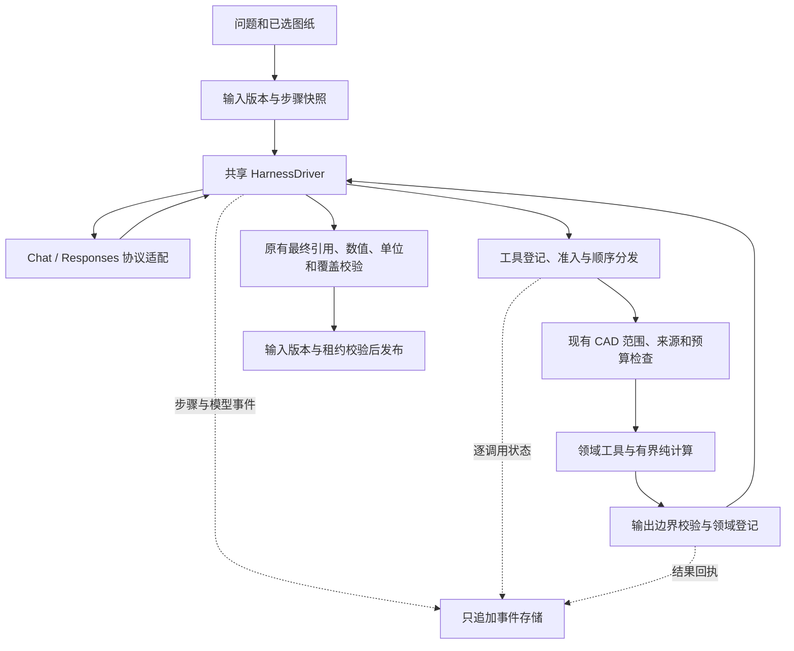

# CAD 自定义 Harness

本次实现将 CAD Opt Agent 的两个自定义运行时接入同一执行内核：API 请求仍用 `native`，直接订阅仍用 `responses_subscription`。入口名称、模型配置、默认模型和付费回退策略没有改变。代码没有依赖外部 CLI 才能运行；历史 `codex` / `deepseek_harness` 入口继续保留为兼容、对照入口。

设计参考固定在 OpenAI Codex `7ac6081623928adead75caa2882e307444edad82` 和 DeepSeek Harness `f3803c96974ad4a94195fb97e5c637e9c2a3afe3`。本次为项目内部实现，没有复制或引入上游源码依赖。参考仓库：[Codex](https://github.com/openai/codex)、[DeepSeek Harness](https://github.com/deepseek-ai/deepseek-harness)。

## 执行边界



`HarnessDriver` 共享步骤快照、输入版本处理、调用 ID 校验、整批登记、工具准入、分发、未执行调用结算以及来源恢复分类。`LoopPolicy` 显式保存两种协议的终轮预留和纠错差异。协议适配器处理函数调用及结果形状；HTTP/SSE、认证、重连以及原有回答修复流程仍在各自运行时中。执行器没有把“工具成功”提升为“事实确认”或“任务完成”。

## 模块

| 模块 | 已实现职责 |
| --- | --- |
| `harness/driver.py` | 共享步骤调度、调用登记、阶段准入、取消与修改问题时的剩余调用结算 |
| `harness/state.py` | 冻结 `StepContext`：问题版本、源文件哈希、要求、工具目录、授权、模型和剩余调用数；显式终轮策略 |
| `harness/model_adapter.py` | Chat / Responses 调用与返回协议；Chat ID 按步骤隔离，Responses 拒绝全局重用 ID |
| `harness/controls.py` | 从旧订阅 CLI 类抽离的预算与最终上下文控制；兼容类继承原接口 |
| `harness/tool_contract.py` | 复用原 Pydantic 输入类型，声明副作用、前置条件、取消、重试和结果投影语义；验证输出为有限数值的 JSON 对象 |
| `harness/tool_pipeline.py` | 单次与嵌套工具调用的状态边界；取消后仍记录已知结果 |
| `harness/events.py`、`event_store.py` | 事件类型、SQLite 只追加事件及不可变完整脱敏附件 |
| `harness/recovery.py` | 租约过期后标注未知结果和未执行调用；不自动重放 |
| `harness/inbox.py` | 持久化完整替换问题，在步骤边界重新建立任务要求，阻止过时答案发布 |
| `harness/scheduler.py` | 静态白名单纯计算，最多两个在途任务，输入复制、按输入顺序交付结果 |
| `analysis/session.py`、`tool_execution.py` | 接入统一工具边界，保留领域检查和登记；无效输出回滚证据、观察及相关登记 |
| `analysis/context_projection.py`、`model_context.py`、`focus.py` | 上下文检查点、来源去重与聚焦接线，保留协议原子和用户指代 |
| `runtimes/stable_prefix.py`、`vision.py` | 工具目录快照和版本、图片发送与审查生命周期 |
| `execution.py`、`service.py`、`app.py` | 租约、发布检查、问题修改及事件查询 API |
| `web/app.js`、`web/index.html` | 执行中“修改问题”入口，读取当前版本并提交乐观并发校验 |

结果边界采用通用 JSON 对象约束。不同 CAD 结果的来源、范围、单位及候选状态仍由各自领域校验器负责；这里没有以通用结构代替领域验证。所有模型工具均视为有会话副作用，包括读取，因为读取会更新证据、覆盖和观察记录。

预算测试的注入点现在是 `harness.controls.BudgetController`。`CodexSubscriptionRuntime` 继承保留旧调用接口，但 monkeypatch 这个子类不会再影响直接 Responses 运行时；历史冻结产物保持原样。

## 工具状态与恢复

模型返回一批合法工具调用后，先为整批生成步骤内稳定 ID 并持久化 `tool.received`，再逐项执行。单个调用经过 `admitted`、`dispatched`，最终进入以下状态之一：

| 状态 | 含义 |
| --- | --- |
| `completed` | 已获得有效返回；仍须领域及最终交付校验 |
| `failed` | 执行后返回错误 |
| `rejected` | 准入或参数检查拒绝，未执行领域处理器 |
| `not_started` | 取消、预算、修改问题或前序中断导致尚未开始 |
| `unknown` | 已派发，但无法确认最终结果 |

`batch_read_sources` 的子调用各自拥有独立 ID。已经完成的工具在随后取消时保留完成回执；取消仍阻止发布。恢复只对未结算调用追加状态，不覆盖旧事件，不把未知结果算作成功，也不自动重放可能已有副作用的调用。重复调用 ID 被拒绝。

事件按运行内递增序号读取。超过 16,000 字符的公开 payload 完整脱敏后存入内容哈希附件，回读校验 SHA-256。SQLite 触发器阻止事件和附件的更新、删除。模型私有推理、认证数据和图片字节沿用 `RunJournal.public_value` 脱敏规则；UI 原有 `RunJournal` 保留为展示投影，执行事件提供独立审计依据。

## 执行中修改问题

只对 `native` / `responses_subscription` 的活动运行开放。UI 和 API 接收的是**修改后的完整问题**，不是任意状态补丁：

```http
POST /api/chat-runs/{run_id}/steer
Content-Type: application/json

{"question":"只读取外墙材料和备注","expected_revision":0}
```

每轮最多四次修改。版本不一致、取消、运行结束或租约过期时拒绝。有效答案返回前，在事务中核对修订并关闭输入：关闭之前接受的修改继续处理，之后提示用户在完成后追问。表格和原文查询的自动捷径也使用同一边界。修改在下一步骤边界应用；等待中的旧模型响应不会执行其工具或发布其答案。应用时重建要求和覆盖，保留已经消耗的调用、轮数、时间、token 和纠错额度。图纸集合保持原选择，动态代码权限只能保持或撤销，不能新增；排队中的权限撤销也不能被后一条中性措辞抹掉。

旧证据保留来源，可按新要求重新使用；旧交付草稿、完成状态、视觉审查状态和当前高亮失效。发布事务再次核对输入版本。完成后的追问使用实际生效的问题。自然语言修改不做“语义必然收窄”的启发式承诺，硬边界是图纸集合、权限和资源预算。

## 上下文与并发

上下文压缩保留原始用户指代、追问历史、修改问题消息、最后一个完整工具调用批次及其结果、图片来源和审查元数据。未闭合调用链保持原样；稳定订阅路径要求至少 10% 的压缩收益，原生聚焦路径保留原有正收益阈值，均继续受硬预算限制。检查点会记录 `context.replaced` 事件和存档引用。没有增加模型摘要请求。

图片仅在请求成功返回后标为已发送；已审查图片不重复附加。工具 schema 以深拷贝提供，附目录哈希和 generation；问题修改导致权限撤销时重新生成提示和工具目录。

并发仅用于 `geometry/candidate_routes.py` 中注册的 `measure_pair` 纯计算。工作线程收到复制后的几何输入，不能访问 Session / Store，也不能提交证据。最多两个任务在途，主线程依输入顺序聚合。取消后丢弃晚到结果。模型工具及证据提交仍顺序执行；`source_read_batching` 仍须用户显式开启。

## 查询和验证

- `GET /api/chat-runs/{run_id}/harness-events?after=0&limit=100`：事件分页，最大 200 条。
- `GET /api/chat-runs/{run_id}/harness-events/{event_id}/payload?start=0&length=6000`：完整脱敏 payload 分页，单页最大 12,000 字符。
- 原有运行详情、过程查看和取消 API 保持兼容。

可复现检查：

```sh
.venv/bin/python -m pytest -q
node --test tests/*.mjs
node --check web/app.js
.venv/bin/python -m scripts.validate_run_inspector --output artifacts/cad-harness-local-check
```

新增测试覆盖冻结步骤、协议 ID、整批登记、跳过与中断、取消后回执、无效输出回滚、并发边界、事件不可变和脱敏、租约恢复、问题版本隔离、权限撤销，以及视觉／追问压缩。最后一个脚本使用真实本地 CAD 工具和脚本模型，不发送模型请求。自动测试和脚本回放不能证明真实模型业务准确率或 token 节省；这两项需使用固定题集、模型、源文件哈希与禁用回退的独立对照。
