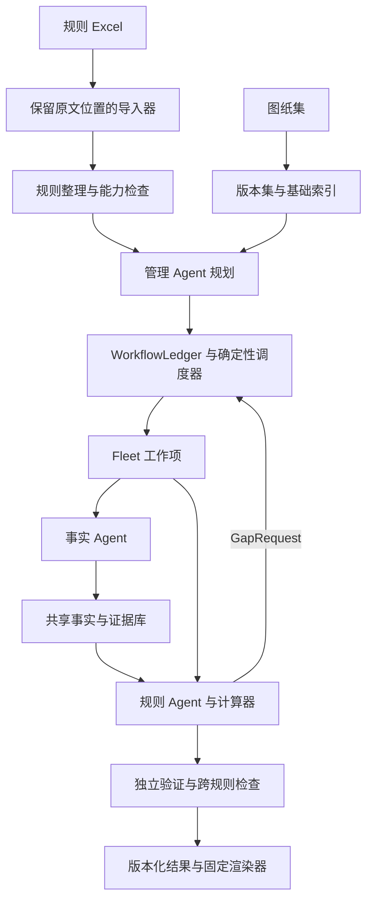

# CAD Opt Agent 规则优化开发计划

日期：2026-10-29。状态：内置规则库、临时库导入和 E0 最小探索底座已完成本地开发；其余阶段仍为开发计划，真实图纸与真实模型验收待进行。当前交付范围、操作及限制见 [E0 使用说明](rule-libraries-e0.md)。

目标是让用户提交一份规则库和一套对应图纸后，系统自动整理规则、规划任务、共享提取图纸事实、逐项分析并补证，最终交付固定格式的优化建议和完整的规则处理台账。现有图纸事实问答继续独立可用。

建议按三个版本交付：先完成最小闭环和探索底座，随后用整套图纸覆盖全库进行探索、按批沉淀公共工具与规则技能，再将通过独立验收的能力发布为稳定版本。跨图、工程几何和成本按实跑发现的缺口逐步补齐。规则附件中的人工判断要求应保留；“所有规则都有处理状态”与“所有规则均已完成自动判断”分别验收。

首批内置规则库确定使用用户提供的建筑规则 Excel。产品同时支持每次临时导入规则库；内置表示来源与发布方式，不表示其中所有规则已经获得自动判断能力。工具和技能优先从真实任务中归纳，不要求预先为全部规则手工编写完整实现。

## 一 交付目标和完成定义

### 用户使用流程

1. 新建项目，选择内置规则库、临时导入规则库或明确组合，并上传图纸集；系统保存原文件、哈希、有效规则清单及导入结果。
2. 系统建立图纸目录，整理规则条件、事实需求、输出要求和能力需求。明确条款自动进入运行，歧义或不支持项单独显示，不阻塞其他独立规则。
3. 系统显示任务范围和预计资源区间，按已配置预算启动；区分开发探索与稳定执行。开发探索可以使用本次任务明确授权的动态代码能力，稳定执行采用冻结的已发布工具和技能。普通运行不要求逐条确认；只有缺失资料、真正的规则歧义或规则明确要求人工判断时请求输入。
4. 管理 Agent 提出任务计划，调度器执行依赖、并发、重试、取消和预算管理。事实 Agent 提交可追溯事实包，规则 Agent 分析并按需申请补证。
5. 用户查看已完成结果、缺证和失败原因；点击建议可以回到原文、图纸位置及计算过程。补充资料后只重算受影响的任务。
6. 系统生成优化建议清单、逐规则处理台账、证据和计算附件。网页与导出读取同一结果版本。
7. 开发探索结束后，系统汇总成功与失败轨迹，产出候选公共工具、规则技能和能力缺口；通过独立回归与留出项目验证后，发布新版本供下一批任务使用。

### 发布范围

| 版本 | 必须交付 | 完成条件 |
| --- | --- | --- |
| R1 规则闭环试点 | 内置/临时规则库、规则规格、事实交接、规则分析、持久化串行运行器、补证、验证、任务内探索记录、固定 JSON 和最小网页；先用 AR004、AR034 检查最小闭环 | 两条规则在不同真实项目上通过分层评测与真实模型 E2E；动态生成通道和验证边界已核对；异常、未决与人工边界有交代 |
| R2 批量规则产品 | 全库条目台账、全库探索运行、共享事实、管理 Agent、Fleet 并发、恢复、公共工具候选与晋升、规则技能版本化、完整界面和 Excel 导出 | 支持范围内的规则全部按契约运行；首轮跨项目沉淀与冻结重跑完成；未支持规则明确展示。此版本不代表全库自动判断已完成 |
| R3 扩展能力交付 | 跨图关联、逐项验收的工程几何、成本适配、跨规则方案检查，以及盘点发现的剩余能力 | 对事先冻结的目标规则清单逐条闭合：可自动化部分通过验收，原规则要求人工的部分正确转交；仍有未支持项时，相关范围不得标记开发完成 |

固定输出先采用 JSON 作为权威结果结构，网页和 Excel 为交付视图。PDF、Word、自动改图、自动替换正式业务结果以及无约束的设计搜索暂不属于本计划的首版交付。成本能力未通过时，可以给出有依据的优化机会，金额保持未知。

R3 的最终目标默认覆盖指定规则库全部有效条目及其原子步骤，包括无编号补充要求。原规则取消或明确“不做”的步骤登记后排除，明确人工判断的步骤实现事实交付和人工转交，其余步骤仍以自动执行为目标。试点清单不能替代最终清单；任何缩减必须记录为用户明确接受的范围变更。规则待澄清和非人工条款的能力缺口均保留未完成状态。

“优化”在首版指依据给定规则识别机会并提出受约束的修改建议。未建立目标函数和全部设计约束之前，不宣称求得全局最优方案。规则库中的企业偏好、标准做法和引用规范分别保存；适用地域、日期和版本不明确时，不能升级成现行规范合规结论。

## 二 当前基础和新增边界

2026-10-29 本地 HEAD 为 `23664f6bbb0a6c3e5488d03972e01591c4407538`，工作区另有未提交的 Fleet、交付契约和服务改动。以下是源码检查结果；上线前必须重新核对实际部署版本和服务行为。

| 领域 | 已有基础 | 本计划新增 |
| --- | --- | --- |
| 图纸与证据 | 来源快照、原文区间、实体和坐标、字段状态、覆盖信息 | 项目图纸版本集、全局来源映射、跨节点可读的不可变事实包 |
| 事实 Agent | 工具调用、局部任务账本、事实与来源验证 | 面向 FactRequest 的执行入口、结构化导出、共享需求归并 |
| 任务执行 | ExecutionManager、局部 TaskLedger、Fleet 队列和执行租约 | 项目级 WorkflowLedger、异质工作项、依赖图、补证循环及预算分配 |
| 分析交付 | 引用、数值、计算与候选状态检查 | RuleSpec、独立规则 Agent、规则结论验证、跨规则冲突检查 |
| 产品 | 单次事实问答、图纸与引用查看、Fleet 任务查看 | 规则库、项目运行、规则覆盖、缺证处理、批量报告和固定导出 |

实现遵守三层职责：**WorkflowLedger 管项目流程，Fleet 管执行所有权，TaskLedger 管一次事实采集内部过程。** 中心不直接写节点的 TaskLedger，不让多个 Worker 共享可写的 Agent SQLite，也不另建一套与 Fleet 争夺执行所有权的队列。

保留现有事实提示词和接口边界。规则逻辑放在独立模块；普通事实问答不能因为上传过规则库而自动变成优化分析。

E0 已修正 Fleet Worker 原先固定开启动态代码的行为：只有原始用户输入的明确授权或本次显式开关可以开启动态代码，明确禁止优先，提问、引用和管理 Agent 改写任务不能产生授权。稳定执行优先使用已发布工具和受限计算器；开发探索允许在授权范围内生成任务程序，不自动改写公共默认版本。

当前 `task_methods` / `task_programs` 已有隔离执行、输入绑定、代码工件和独立验证。E0 已将任务内生成入口接入当前 native API 配置，保留原 `responses_subscription` / `gpt-6.1-sol` 通道；通道与预算回归使用模拟 provider/sandbox，真实执行仍需验收。`register_program` 在至少两组不同来源哈希集合执行通过后只登记为 experimental，不证明跨项目泛化，也不自动成为公共工具。另有 adaptation 注册路径，应统一其含义；现有代码尚未提供产品内规则技能的注册和加载机制。

## 三 目标架构与运行过程

### 单次运行的步骤

1. 冻结 `drawing_set_version`、`rule_set_version`、模型和工具配置、预算及用户授权上下文。运行过程中不偷偷切换到新图或新规则。
2. 先完成图纸清单和低成本索引，再按规则产生事实需求。标题、文件名、楼层标签和工程对象关联分别记录证据状态。
3. 管理 Agent 输出规则应用范围、任务依赖和候选事实需求；程序校验无环、规则覆盖、能力、权限和预算后落库。
4. 归并等价 FactRequest。相同对象、范围、字段和口径共享提取；名称相同但版本、楼栋或含义不同的需求不合并。
5. 就绪事实任务通过 Fleet 执行。事实包先保存并验证，再发布为可引用版本，解除下游依赖。
6. 规则 Agent 判断适用性、例外和优化条件。确定性比较及算术交给程序；缺事实返回 GapRequest，不能自行补造原设计数据。
7. 调度器去重补证请求。默认同一缺口最多两轮有效补证；无新增来源、重复失败或预算不足时停止，并保存未决原因。该默认值在试点实测后调整。
8. 独立校验引用、对象、单位、完整性、前置条件和计算；检查跨规则的重复、互斥和收益重叠。
9. 发布不可变结果版本。执行成功、业务判断完成、建议通过校验分别记录；部分成功允许交付，但必须列出未决项。

管理 Agent 负责语义拆解和计划修订。依赖推进、领取、重试、超时、取消、幂等发布和预算扣减由程序执行。计划修订保留版本，不覆盖已运行任务的历史依据。

每条规则先有“范围发现与对象枚举”父任务，记录候选来源清单、应检范围、已检对象、未解析区域和覆盖缺口。只有达到该规则的枚举完成标准，才能关闭整体完整性状态；管理 Agent 生成了多少子任务不能定义总体分母。范围未知时，产品显示“已发现实例均已处理，整体范围未确认”，不能显示整条规则已完成。已读分页和解析文字覆盖也不能单独证明工程对象枚举完整。

R1 先实现持久化的串行运行器，完成事实采集、规则判断、补证、验证、发布及失败记录。它采用后续 WorkflowLedger 的契约和状态存储，不另做一次性脚本；P5 再扩展动态管理、共享调度和多节点并行。

### 从实跑到公共能力

启动时只要求最小底座可靠：图纸导入与原文/实体读取、范围检索、来源定位、版本快照、结构化事实包、隔离执行、计算与结果校验、完整运行记录。复杂的建筑公共工具和规则专属工作方法可以通过实跑逐步形成。

开发探索以“已有能力检索 → 组合已有工具 → 识别明确缺口 → 生成任务工具 → 执行与独立验证 → 记录结果”为循环。没有通过验证的输出只能作为待核查候选，不能进入正式事实和优化建议。模型服务错误、文件缺失或规则歧义应分别处理，不因任何失败都生成新工具。

当前动态程序的验证契约主要覆盖有限的文本操作和基础几何方法。对于新算法族，模型可以提出实现和测试草案，但必须补充独立的输入/输出定义和验证依据；生成程序不得自行降低验证要求或给自己的新结果类型授予证据资格。复杂工程对象身份和可实施性仍需独立参考。这项限制用于区分“可以探索”与“可以可信交付”，不要求事先实现完整算法。

每条规则完成一个应用实例时立即归档经历；每完成一小批相关规则进行去重和候选整理；每套项目完成后做项目级总结，多套项目完成后做跨项目抽象。无需等所有规则成功才整理，也不因一次成功就发布公共工具。某条规则失败或待人工判断时，其他独立规则继续。

一批运行开始时冻结规则、公共工具、技能和验证器版本。批内新程序只属于任务或明确的实验版本；共享候选需要登记和重新绑定依赖，不能偷偷改变正在运行任务的工具。升级发布后，再用新版本重跑受影响任务和回归集，保存升级前后的结果。

### 规则 工具 技能和经历分开保存

| 资产 | 回答的问题 | 内容与边界 |
| --- | --- | --- |
| RuleSpec | 按什么业务条件判断 | 有效规则原文、适用/排除条件、阈值、建议动作和输出要求；业务含义由此维护 |
| Tool | 哪个操作可以执行并验证 | 输入输出、前置条件、算法、证据、错误与验证器；公共工具不固化某个 AR 编号的阈值 |
| Skill | 这类任务如何组织完成 | 查哪些来源、怎样使用工具、如何处理分支和补证、何时停止或转人工；引用规则和工具版本 |
| CaseRecord | 某次任务实际发生了什么 | 输入版本、观测、代码、工具调用、失败原因、修复、验证及最终状态；作为归纳材料，不直接成为普遍指令 |

公共工具可以分为基础操作、建筑领域共用操作和规则专用辅助操作，不强求每个工具跨专业通用。多个规则都依赖“构造做法层次读取”时可以抽象为建筑公共工具；只服务一条规则的特殊计算可以保留为专用工具。复用价值由语义、适用范围和验证证据决定，不只按调用次数排序。

规则技能可以采用规则入口加共用取证方法：事实 Agent 读取中性的做法/表格/对象取证技能，规则 Agent 加载对应规则分析技能。共享代码存入工具库，不在每份技能里复制；规则阈值和有效条件引用 RuleSpec，避免规则库与技能各维护一份业务真相。

### 能力归纳和晋升

工具状态建议采用 `task_local → candidate → validated → released → deprecated`，另有 rejected/quarantined 表示不合格或暂停使用。模型可以自动完成候选整理、接口提议、测试生成和回归运行；常规晋升按预先确定的检查执行，不要求每次人工审批。规则含义争议、新工程量定义、缺少独立参考等事项仍需要相应业务判断。

候选公共工具需具备：明确的语义与前置条件、输入输出 schema、来源保持、受控依赖、版本、正例/负例/边界测试、错误处理、取消和预算行为、旧任务回归、独立项目使用证据。不能硬编码项目名、文件名、已知答案或固定坐标。不同测量口径不能因为代码相似就合并。同一规则两张相似图执行成功，只能形成候选证据，不能证明通用性。

规则技能需包含：触发范围、兼容规则版本、所需事实、工具依赖、核心流程、已观察到的分支与失败模式、补证/停止/人工条件、输出要求、测试及已知局限。将大段案例放在按需加载的参考中；具体项目数值留在本地案例库，不写入通用技能。业务偏好不能从某次成功经验中升级为强制规则。

跨规则依赖图记录“哪些规则使用哪些工具和技能、版本是什么”。根据影响范围和缺口频次确定改进优先级；某个公共工具升级时重跑所有依赖规则的相关回归。工具和技能发现只加载与当前任务有关的摘要及必要正文，避免将整个库塞入上下文。

每批沉淀后比较冻结基线、仅增加工具、仅增加技能及两者同时增加的结果；数据充足时用消融评测判断各自贡献。首轮至少比较升级前后质量、有效结论率、补证次数、新工具生成率、重复采集和成本。工具数量或技能文档数量不作为成功指标。

### AR034 的依赖示例

完整提取一个外墙做法及其适用部位 → 识别砂浆层并记录各层来源 → 确认相关层次覆盖完整 → 计算原设计与标准做法的砂浆总厚度 → 判断砂浆厚度优化的前置条件 → 条件满足才逐层分析厚度 → 继续其他做法比较 → 验证结果。

不能将每层砂浆作为完全独立任务后直接汇总建议。缺少一层时，总厚度比较保持未知；不能把缺失层厚度算成零。

## 四 优先确定的数据契约

首轮先实现带版本的 Pydantic 模型、JSON Schema、合法和非法样例。后续模块依契约并行开发，避免反复改接口。

### 内置和临时规则库

首批内置库建议 ID 为 `architecture-cn`，来源固定为 `/Users/vigorchen/Documents/Work/规则及数据/建筑/20260320 优化规则库-建筑.xlsx`。实现时保存完整原文件及图片/单元格关系、导入清单、原文哈希、有效修订解释和编译后的 RuleSpec；以发布版本与源哈希共同标识，不能仅以文件名日期确定版本。内置库按版本不可变更新，已有运行保持原绑定。

临时导入走相同解析和验证链，默认作用于当前项目中的指定运行，不自动加入内置库。临时表示生效范围有限，不表示结束后删除报告所依赖的证据；原始规则和解释版本按结果留存需要保存，避免历史报告失去依据。

规则身份使用 `library_id + rule_id + rule_version`。显示编号相同不等于同一规则，临时库使用独立命名空间。组合运行支持三类显式操作：新增规则、停用所选规则、替换指定规则版本。默认将同名但来源不同的规则保持独立；替换必须指向基准库/规则/版本并保留差异，不能按导入顺序或文件名静默覆盖。

运行前生成 EffectiveRuleSet，列出内置基准、临时增补、停用/替换和未解冲突，并冻结清单哈希。内置库更新不改变正在运行或历史任务。临时规则成熟后可形成新的内置候选版本，通过规则级验收后发布；一次临时使用不会自动成为公共默认规则。

RuleSpec 编译时区分正式执行资格与探索资格。业务含义未确定的规则可以采集相关事实和记录疑点，但不能生成确定的优化判断；业务含义明确而工具不足的规则可以进入已授权的探索路径，未验证结果仍保持能力缺口。新导入规则未有专属技能时，先通过通用规则流程和已有工具执行，不以“没有技能文件”作为必须停止的理由。

| 契约 | 必须包含的内容 | 关键约束 |
| --- | --- | --- |
| ProjectManifest | 项目、图纸集合版本、文件哈希、转换版本、专业/楼栋/楼层/版次、来源关系及确认状态 | 用户标签、文件名推断和源图确认分开；同名文件不能覆盖旧版 |
| RuleSpec | 规则 ID/版本、原文单元格与图片、修订依据、适用/排除条件、事实需求、比较顺序、建议动作、计算和输出要求、人工边界 | 保留取消及“不做”项；未解歧义或不支持操作不能获得正式执行资格，探索资格另行判断 |
| FactRequest | 对象/范围、所需属性、单位和测量口径、证据要求、是否完整枚举、订阅规则、预算与停止条件 | 证明一个实例存在与证明全部实例满足要求，使用不同覆盖标准 |
| FactPackage | 不可变包 ID、来源快照、对象绑定、事实值、原文引用、单位、获取方法、覆盖、冲突和缺项、工具版本 | observed、derived、unknown、conflict 保留；候选关联不能升级为确认事实 |
| GapRequest | 缺口类型、关联规则与条件、目标对象、已查范围、所需证据、前序尝试 | 去重并记录是否有新信息；规则不清与图纸缺证分流 |
| RuleAssessment | 规则与事实版本、适用性、判断状态、引用、条件求值、计算记录、建议、缺项和验证结果 | 结论不能覆盖或修改原始事实；独立保存判断和执行状态 |
| Recommendation | 对象、原设计、修改动作、目标值/方案、成立条件、影响范围、关联/互斥建议、收益及依据 | 候选建议与通过校验的建议分开；金额未知不写零 |
| ReportManifest | 运行 ID、图纸/规则/事实/模型/提示/计算/模板版本、结果索引、覆盖台账、导出校验信息 | 报告可追溯；重跑生成新版本，不覆盖既有确认记录 |
| EffectiveRuleSet | 内置版本、临时库、显式增补/停用/替换、有效规则清单、冲突和清单哈希 | 无隐式覆盖，运行中不漂移 |
| CapabilityPackage | 工具或技能 ID、版本、适用范围、依赖、来源经历、验证记录、发布状态 | 注册候选与正式发布分开；复用代码或方法不复用旧图事实 |
| CaseRecord | 项目/规则/图纸版本、能力缺口、方法、代码与输入输出、失败分类、验证、预算、最终状态 | 包含失败尝试；可归纳、可重跑，不保存隐藏思考过程 |

### 规则解释与计算

规则导入器先保留原始结构，再由模型整理语义；不能只按 Excel 表头映射业务含义。首版要支持合并单元格、继承范围、隐藏行列、取消项、无编号补充行、图片锚点、备注和修订记录。规则依赖图片内容时，必须读取图片并建立对应证据；尚未读取时标记待解释，不能算导入完成。

规则规格分为导入、待澄清、可执行、不支持、停用等生命周期状态。明确、可验证的规则可自动通过结构检查；需要业务裁决的冲突才请求人工处理。新的自然语言规则优先组合已注册的比较、条件、集合、分层对比和计算操作；能力不足时区分可在既有契约内生成任务工具的缺口与需要新增验证契约的缺口，均不得绕过验证器授予结果证据资格。

首版计算器支持有类型的单位换算、比较、条件组合、集合筛选、完整集合求和与差值。禁止通过 `eval` 执行单元格或模型字符串。使用 Decimal 等明确数值策略；精度和舍入由字段契约定义。规则求值使用真、假、未知三态，未知不得自动转假。条件解释、原始事实与建议假设分别保存。

### 运行和业务状态

- 执行状态：`queued / running / waiting_input / completed / partial / failed / cancelled`。
- 适用性：`applicable / not_applicable / unknown`。
- 判断结果：`suggestion / no_suggestion / not_applicable / insufficient_evidence / rule_ambiguous / unsupported / requires_human`；执行失败另由执行状态表达。
- 验证状态：`pending / passed / rejected`；通过自动验证不等于设计单位确认可实施。
- 收益状态：`calculated / unknown / not_requested`。

前端由这些维度生成可读状态，不能仅依据 HTTP 成功、模型返回或 `completed` 显示“无优化项”。

### 首版固定输出

建议清单固定包含：建议编号、规则编号及版本、楼栋/楼层/部位、图纸与定位、原设计事实、判断依据、建议修改、成立条件、工程量变化、计价依据、预计收益、验证状态。复杂计算和原文放在可展开附件，列表保持可扫描；字段不适用与数据未知分别表达。

规则处理台账按规则应用实例列出：规则、对象/范围、执行状态、适用性、判断结果、缺证或失败原因、关联建议编号、下一步。停用和取消规则在导入台账保留，但不混入活动规则的完成率分母。各分母和目标范围随运行冻结。

JSON 使用有类型的数值和单位，未知值为 `null` 并附原因；网页和 Excel 显示“未知”“不适用”等可读文字。规则专属输出锚点作为结构化字段保存，不通过临时拼接提示词决定。导出应保留来源索引和运行清单，受保护的来源链接继承项目访问权限。

用户补充条件、人工确认或纠正必须有独立来源类别、操作者、时间和适用范围。它们生成新版本和重算记录，不覆盖图纸原文，也不能伪装成图纸直接表达的事实。撤回或替换确认时，下游结果按依赖失效。

## 五 规则试点和扩展顺序

以下定位来自指定规则库的工作表“建筑设计优化要点表”。它们用于确定开发能力和测试范围；规则整理时仍需冻结原文、修订解释及其版本。

| 批次 | 规则 | 所需能力和验收重点 | 首次交付范围 |
| --- | --- | --- | --- |
| 第一批 | AR004 底板防水 | 完整做法、层次和适用部位；防水等级等前提；标准做法对比。E19:F22、D19、L19:L22、M19:Q19 | 有证据的做法差异与候选建议；未有完整量价依据时不输出金额 |
| 第一批 | AR034 外墙做法 | 完整层次、砂浆分类和厚度聚合；总厚度门槛；其他比较不被误停。E149:F152、L149:L153、M149:O153 | 先总体条件再分项判断，提供可复算记录 |
| 第一批人工边界用例 | AR024 墙体工程 | 墙类型、内外墙、保温条件、材料及原文定位。F109:F111、L109:L111 | 验证事实提取、定位与人工转交；F111 的人工分析要求不自动升级为自动优化 |
| 第一批边界用例 | AR008 | C34/D34 与 F34、G34 修订说明的解释关系 | 先验证歧义识别和隔离；业务解释明确后才加入自动判断范围 |
| 第二批 | AR032 门窗 | 说明、门窗表、大样、节能专篇的关系；甲方例外；未找到的覆盖证据；输出锚点。F140:F141、M140:V144 | 先完整事实包，再启用已验收的规则判断及定位 |
| 第二批 | AR023 | 保温厚度与其他做法按属性选择来源，F107 | 验证属性级来源优先规则，不能一概指定某张图优先 |
| 第三批 | AR002 设备用房位置 | 地下室与首层对象对应、空间范围和设备分类例外，E6:F8 | 上下层关系有依据时分析；关系未知则补证 |
| 第三批 | AR009 汽车坡道 | 最不利位置、凸出物、完成面/结构面、粉刷及净宽语义，F37:F38 | 几何事实逐项验收；保留坡道类型优化的人工判断边界 |

P0 对全库生成“规则 × 原子步骤 × 能力 × 输出 × 自动/人工边界”矩阵。取消项、不做项和无编号补充项都要对账。第一批两条规则只用于尽快暴露最小闭环问题，不限定后续探索只能处理它们。最小底座通过后，第一套开发图纸即建立全库任务台账，按共享事实和依赖分批探索；无法形成有效结论的规则交付方法、证据和缺口。R2 至少形成 5 条已明确且受支持规则的稳定交付，并继续对全库未闭合项推进；不能为了凑数量把未支持规则标成已实现。

每条试点规则至少准备触发、不触发、不适用、缺证、来源冲突和服务失败六类场景；存在阈值的规则加等于阈值及两侧，存在人工边界的规则加正确转交场景。

试点前的业务解释清单应特别包含：AR034 哪些材料计入砂浆总厚度、未标单位的处理及标准做法中不明确文字；AR008 修订覆盖和材料偏好成立条件；AR032 补充输出要求与原有人工判断文字的关系；AR023 F108 补充与 F107 的关系及百分比比较口径。可以分规则解决，未明确的分支保持待澄清，不能由模型猜出解释后作为验收标准。

## 六 阶段工作计划

下表保留基础平台的初始等效工程人日估算，包括实现、回归、真实样本修正和文档，不包括等待图纸、专业裁决及外部服务的时间。新增加的双规则库、动态生成通道适配及工具/技能沉淀工作见 E0–E4；在最小底座和首轮实跑后重估，不能将原有合计直接视为新版总工期。编码 Agent 可并行承担独立工作，但不能据此直接换算为固定日历天数。

| 阶段 | 工作内容 | 必交付物 | 退出条件 | 依赖 | 估算人日 |
| --- | --- | --- | --- | --- | --- |
| P0 基线与范围 | 冻结当前工作区来源；核对 Fleet 与事实能力；全库能力盘点；选择项目和标注规则；明确输出与严重错误定义 | 来源清单、能力矩阵、试点样本清单、验收协议、现状缺陷清单 | 每条试点规则都有确定解释或明确阻塞；现有测试基线和未验证项分开 | 无 | 2–3 |
| P1 规则导入与整理 | Excel 无损来源提取、规则规格、修订与图片关系、能力检查、内置/临时库和有效规则清单 | RuleSpec、导入器、整理器、逐条导入对账、版本/组合样例 | 首批内置建筑库可选，临时导入不污染默认库；规则原文可回源，取消/补充/歧义不丢失 | P0 | 原估算 3–5，新增项在 E0 重估 |
| P2 项目与共享事实契约 | 项目版本集、来源映射、事实需求/事实包/缺口模型、中心存储和兼容迁移 | 契约样例、数据库迁移、中心事实读取接口 | 不混图、不混对象、不混版本；节点离线仍能读已发布证据包 | P0；与 P1 并行 | 3–5 |
| P3 事实 Agent 适配 | 需求转采集任务、现有账本复用、证据包生成/导出/校验、覆盖状态、授权传递 | FactRequest 执行入口、结构化事实包、原问答回归 | 完成/部分/取消/失败均真实表达；未读来源不入包；动态代码不自动授权 | P2 | 4–6 |
| P4 规则分析与验证 | 独立规则运行时、三态条件、做法对比、确定性计算、持久化串行运行器、补证、规则验证和初步冲突检查 | RuleAssessment、最小 WorkflowLedger、计算记录、验证报告、AR004/AR034 闭环 | 固定事实包测试和真实图纸分别通过；无依据建议被拦截 | P1、P2；可先用固定事实包与 P3 并行 | 5–8 |
| P5 管理与批量调度 | 扩展串行底座：管理 Agent、项目任务图、需求归并、异质 Fleet 工作项、重试/恢复/取消、版本失效和预算 | 完整 WorkflowLedger、能力调度、事件记录、故障注入结果 | 每项有状态；重复和迟到提交不双发布；补证有界；固定回放一致，真实模型质量不退化 | P3、P4；协议设计前置 | 4–6 |
| P6 界面与固定输出 | P6a 最小结果页和 JSON；P6b 上传与范围查看、进度/覆盖、缺证补充、来源跳转及 Excel 导出 | 最小结果页、完整产品流程、模板、报告版本 | 网页与导出一致；所有建议可回源；未决与失败可见；特定规则定位正确 | P6a 依赖 P4；P6b 集成依赖 P5 | 3–5 |
| P7 验收与发布 | 分层测试、封存项目集、真实 E2E、性能/费用、影子运行、部署/回滚/恢复 | 验收报告、发布清单、操作说明、已知限制 | 达到约定门槛，完成实际结果读回和回滚演练 | 测试贯穿 P0–P6，发布依赖 P6 | 4–6 |

前版 P0–P7 合计约 28–44 等效工程人日，仅作为基础平台估算参考；增加探索沉淀机制后，R2 总工期需重新估算。R1 位于 P3/P4 集成及 P6 最小结果页完成之后，须提前执行相应 P7 验收，不能等到全量功能完成才第一次看真实结果。

建议首批工作顺序：P0 → P1/P2 并行 → P3/P4 并行 → P6a 与 R1 验收 → P5/P6b 集成 → P7 批量发布。P6a 约占 P6 的 1–2 人日，已包含在表内，不另加总。UI 骨架、评测和契约审查可前置，业务依赖未满足时使用明确标记的固定测试输入。

### 图纸驱动的探索与沉淀工作

| 工作包 | 执行时点与任务 | 产物与退出条件 |
| --- | --- | --- |
| E0 最小探索底座 | 与 P1–P4 集成：内置/临时规则清单、明确授权、实际模型通道生成适配、隔离执行、证据和经历记录；先跑少量规则检查链路 | 真实调用证明生成/执行/校验可用；不把订阅路径的成功当 API 路径已通过；未授权任务不能生成执行 |
| E1 第一套图全库探索 | 最小闭环后，对开发项目 A 的全部有效规则建台账，按依赖和预算执行；现有能力优先，缺口触发任务内探索 | 每条规则的结果或阻塞原因、完整 CaseRecord、任务工具和方法候选；失败不等待无限修复 |
| E2 单项目整理 | 每个相关规则批次及项目 A 结束时归并候选，按共享事实操作和方法分组 | 候选工具接口、规则/共用技能草案、依赖图、开发回归；保留专用方法，不强行公共化 |
| E3 跨项目归纳 | 在开发项目 B 等不同来源图纸上，先用冻结候选运行，再对失败进行独立探索修复并记录前后结果 | 验证实际可迁移范围；去掉项目特例；生成带版本的工具和技能候选，重跑已有开发回归 |
| E4 冻结与留出验收 | 不参与归纳的项目 C 使用冻结规则、工具、技能和运行配置；稳定交付验收不边测边修改公共能力 | 独立验收报告、可发布版本、未闭合能力清单；若将失败样本用于修复，该样本转入回归并补充新留出样本 |

如果只有两套图，先用一套开发、一套留出；样本少时只声明已验证范围。若另行评估“新图上自主修复”能力，应单列试验：冻结初始工具、生成预算、权限和验证器，分别报告首次结果及修复后结果，不能混入稳定工具集的直接泛化成绩。

E0–E4 是贯穿 P1–P10 的增量工作，不是每轮都重建整个平台。首轮实跑后按缺口类别、共享程度、验证难度和预期收益排序，决定下批开发重点；跨图和几何能力不必全部预写，但正式交付仍须达到 P8/P9 的工程验收要求。

### R3 扩展工作

| 阶段 | 工作内容 | 独立验收门槛 | 估算人日 |
| --- | --- | --- | --- |
| P8 跨图与来源关系 | 图纸关系、楼栋楼层对应、修订关系、属性级来源优先、跨图对象映射 | AR023/AR032/AR002 的已选场景通过；同名异对象、新旧图、坐标未对齐不能误关联 | 6–10 |
| P9 工程几何 | 按具体规则建立对象身份、边界、坐标变换、净尺寸口径、遮挡与最不利位置处理 | 每种量测均有独立人工参考和允许误差；AR009 的几何证据与人工判断界限分别验收 | 8–15 |
| P10 成本与方案组合 | 工程量来源、套价接口、单价版本/地区/时点、税费口径、替代方案、重叠收益与组合重算 | 量价全链可复算；缺量价不输出金额；组合收益不重复；断开成本服务仍可交付明确未计价建议 | 5–10 |

上述扩展原估算另需 19–35 人日，前版基础与扩展合计 47–79 人日；这些数字不包含新增 E0–E4 的完整工作量。实跑归纳可能减少重复实现，也可能发现新的算法与验证缺口，应据首轮证据重估。R3 是否完成按全库目标规则矩阵验收，不能用“已完成 P8–P10”替代逐规则确认。

## 七 模块和可合并工作包

目录和接口名称为建议，实施前按现有结构确认；不要求引入新的大型 Agent 框架。第一版继续使用 Python、Pydantic、现有模型适配器和中心 SQLite。持久化先保证单一写入所有者、短事务和显式迁移；只有实际并发测量表明需要时再升级数据库或消息设施。

| 工作包 | 主要落点 | 合并前必须证明 |
| --- | --- | --- |
| T01 基线与迁移 | `fleet/migrations.py`、现有 Store、基线清单 | 旧记录可读，迁移可恢复，未提交改动来源已核对 |
| T02 项目版本集 | `projects/contracts.py`、`projects/store.py`、`projects/api.py` | 同名异版隔离，图纸集合不可变，修改产生新版本 |
| T03 规则原始导入 | `rules/import_excel.py`、`rules/source.py` | 单元格/合并/图片/备注/取消项来源完整，导入问题明确 |
| T04 规则整理 | `rules/contracts.py`、`rules/compiler.py`、`rules/capabilities.py` | 条件、例外、人工边界可追溯；语义不明确不能获得正式判断资格 |
| T05 事实契约与存储 | `facts/contracts.py`、`facts/requests.py`、`facts/packages.py`、`facts/store.py` | 等价需求归并正确；无跨版本或跨对象污染 |
| T06 事实适配器 | `facts/runner.py`、`facts/exporter.py`、现有会话接口 | 有证据交接、实际覆盖与缺项、授权透传；原问答不退化 |
| T07 规则运行与计算 | `rules/runner.py`、`rules/evaluator.py`、`rules/calculations.py`、`rules/prompts.py` | 固定事实包的适用性、阈值、例外、三态和补证测试通过 |
| T08 验证与建议 | `validation/rule_result.py`、`validation/cross_rule.py`、`findings/contracts.py` | 错证据、错对象、错单位、未知前提和重复收益被拦截 |
| T09 项目编排 | `orchestration/contracts.py`、`ledger.py`、`planner.py`、`scheduler.py` | T09a 串行账本随 P4 交付；T09b 在 P5 扩展；依赖无环、范围父任务不漏项、补证去重、预算不被重试重置 |
| T10 Fleet 集成 | 现有 `fleet/app.py`、`store.py`、`worker.py` | 按任务能力路由；重启、租约过期、迟到和重复回执不双发布 |
| T11 产品与报告 | `reports/schema.py`、`renderer.py`、`exporters.py`、现有 Web | 最小结果页先交付，后补批量/缺证/导出；各视图数据一致 |
| T12 验收与发布 | `tests/`、`evals/rules/`、`evals/projects/`、发布文档 | 可重放评测、真实 E2E、故障恢复、灰度和回滚全部有记录 |
| T13 工具和技能资产 | `capabilities/contracts.py`、`registry.py`、`promotion.py`、`rule_skills/loader.py`、`experiments/cases.py`、`experiments/consolidate.py` | 统一候选状态、批次版本冻结、经历归纳、规则/工具依赖、选择性技能加载、跨项目验证和回退；不自动传播未经验证的新能力 |

T02 与 T03 可并行；T05 依赖 T02 和规则需求契约；T06 与 T07 可在契约稳定后并行。T09a 为 R1 必备；T09b/T10 的接口提前确定，完整集成在 T06–T08 后进行。T11 以固定样例先建立最小查看能力，R1 前接真实结果。T12 从 T01 起持续维护；T13 的经历记录和资产契约在 E0 前置，晋升和技能加载随 E2–E4 完善。T01–T13 是可审查工作包，可按复杂度拆成小 PR，不自动创建或合并 PR。

### 持久化和接口

建议中心新增 `projects`、`drawing_sets`、`drawing_members`、`source_bindings`、`rule_sources`、`rule_versions`、`fact_requests`、`fact_packages`、`fact_subscriptions`、`workflow_runs`、`work_items`、`work_dependencies`、`workflow_events`、`rule_evaluations`、`calculation_runs`、`findings`、`validation_reports`、`report_versions`。复用 Fleet 的 `jobs`、`attempts` 和节点元数据，不复制执行租约状态机。

双规则库增加 `rule_libraries`、`rule_set_overlays`、`effective_rule_sets`；能力沉淀增加 `capability_versions`、`skill_versions`、`case_records`、`promotion_runs`、`capability_dependencies`。现有实验程序工件通过引用接入，不复制成互相矛盾的两套代码资产。

核心外部 API：

- `POST /api/projects`，`POST /api/projects/{id}/drawing-sets`，`GET /api/drawing-sets/{id}/manifest`。
- `POST /api/rulebooks`，`GET /api/rulebooks/{id}/rules`，规则解释修订生成新版本。
- `GET /api/rule-libraries` 选择内置版本；临时导入声明作用域；有效规则集接口保存显式增补、停用和替换。
- `POST /api/projects/{id}/analysis-runs`，绑定图纸集、规则集、预算、输出模板及授权上下文。
- `GET /api/analysis-runs/{id}/plan|coverage|findings|validation|report`，实际实现为分别定义的路径。
- `POST /api/analysis-runs/{id}/cancel`，`POST .../resume`；新增资料创建新依赖版本和可追踪的后续运行。
- `GET /api/analysis-runs/{id}/export?format=json|xlsx`，事实包及证据详情读取接口。
- 能力目录、技能版本、探索经历、候选归纳、晋升与回滚接口按产品权限开放；内部资产状态不能由模型直接写成 released。

一次事实工作项对应一个 Fleet job；每次 job attempt 对应一个节点内运行及局部 TaskLedger。中心将经过验证的不可变结果包发布后再推进依赖。文件先按内容哈希落盘，再以短事务提交索引；同库原子提交或事务 outbox 保证状态与工作项不会失配。发布前校验 attempt token、版本和唯一键，不能仅靠进程内锁。

Worker 声明 `fact_extract / rule_evaluate / result_validate` 等能力，Job 通过版本化 `task_kind` 和 `input_refs` 分发。模型能力、上下文和视觉支持参与匹配；不把某个模型名称写死为一个永久角色。

### 缓存和局部重算

事实缓存包含实际依赖的图纸版本、对象/范围、属性、单位口径、提取器/工具版本及必要模型配置。规则结果缓存再包含 RuleSpec、事实包、计算和验证器版本。报告缓存还包含模板版本。

图纸更新只失效依赖该图及关联关系的事实与判断；规则阈值变化不必重新提取未改变的事实。项目集合版本作为上下文保留，实际复用经依赖来源核验。每次失效记录原因，不以“已有同名结果”作为复用依据。

## 八 验收数据和质量门槛

以下数值为建议目标，P0 应根据实际规则、风险和标注一致性冻结。它们不是当前系统成绩，不允许在测试失败后通过缩小分母或改解释来达标。

### 数据准备

R1 至少采用两套不同来源/制图方式的真实项目，覆盖两条试点规则；R2 目标至少五套项目、五条已支持规则。数据数量是起点，不能替代案例覆盖。以“规则 × 预先定义对象或范围”为评测实例，记录对象清单是否完整。

按项目划分开发集和封存验收集；同项目不同楼层、修订图或近重复详图不跨集合。提示示例、演示案例和用于修复的样本归入开发/回归集。封存样本用于修复后需要补充新的未见样本。另设未见规则表达测试，检查是否只是记住 AR 编号或规则原句。

参考答案保存适用性、关键事实、原文位置、对象范围、允许的等价表达、计算依据、预期缺项和人工边界。关键工程判断由有相应业务能力的人复核；单人开发时，业务复核可以兼职，但不能用另一个模型的同意代替独立参考。

### 分层验证

| 层次 | 输入 | 验证重点 |
| --- | --- | --- |
| L1 规则导入与整理 | 冻结工作簿及规则来源 | 条目不遗漏、原文位置、修订关系、条件/例外、输出要求和人工边界 |
| L2 确定性规则求值 | 人工核对的规范化事实 | 三态逻辑、阈值等号、集合完整性、单位、公式及建议动作 |
| L3 图纸事实提取 | 冻结图纸/转换产物 | 值、单位、适用范围、对象绑定、原文位置、覆盖和冲突 |
| L4 固定证据包分析 | 独立冻结事实包 | 规则 Agent 的判断、补证、拒绝无依据结论、跨规则冲突 |
| L5 完整集成 | 原始图纸和规则库 | 导入、规划、提取、判断、验证、输出、故障恢复 |
| L6 真实服务 E2E | 实际模型和部署入口 | 真实请求、持久化、前端/导出读回、来源定位和运行清单 |

回放、确定性工具测试和真实模型 E2E 分开报告。模型 502、超时、零输出、部分完成都不能当作规则通过。自动 LLM 评审可用于发现问题，最终门槛不能仅依赖 LLM 自评分。

### 必须覆盖的负例

- 缺失与零、未找到与不存在、局部检索与完整枚举。
- 阈值及其两侧、单位缺失或米/毫米混用、范围或时间不一致。
- 否定、例外、特别要求、总说明与局部详图冲突、旧版与新版混用。
- 同名对象跨楼栋或楼层、图框相邻但不属于同一做法、局部属性被套用到全项目。
- 层次不完整却求总厚度、几何距离冒充净宽、候选轮廓冒充确认房间。
- 多条建议互斥、修改同一对象造成收益重复、缺少单价被写成零成本。
- 规则正文夹带无关执行指令、规则 Agent 改写授权、原始输入明确禁止动态代码。
- 模型失败、进程退出、重复提交、租约失效、迟到结果、证据包损坏及预算用尽。

### 发布门槛

| 指标 | 定义与建议门槛 |
| --- | --- |
| 结构和引用硬门槛 | 发布的报告均符合 schema；发布的事实引用均可解析到对应来源；确定性计算均可复算并符合预定误差。验收集上要求 100% |
| 严重错误 | 验收集上无严重无依据建议、错误对象绑定、未知前提被当作已知、失败伪装无问题或未授权动态代码执行 |
| 建议准确率 | 经独立核对正确的建议数 / 已输出建议数，首轮目标 ≥95%；零建议时指标为不可评估，不能记 100% |
| 机会召回率 | 正确发现的优化机会数 / 已标注真实机会数，首轮目标 ≥85%；参考集中无机会时单独报告，不用于证明召回 |
| 状态覆盖率 | 已交代终态的预期实例 / 全部预期实例，目标 100%；证据不足或失败只能计为已交代 |
| 有效结论率 | 有依据的有建议、无建议或不适用实例 / 全部预期实例；R2 在资料完整且能力受支持的冻结验收子集上目标 ≥90%，同时报告全体比例 |
| 适用规则完成率 | 完成有/无建议判断的实例 / 预先标注适用实例；未知适用性单列，并给保守口径，不能靠改标不适用提高成绩 |

每项报告分子、分母、规则类别、样本规模和统计不确定性。文本、跨图、几何和成本分开评分。对标注分歧先处理规则解释或参考答案问题，不把分歧静默算模型正确。

### 性能和资源

同一冻结任务集比较串行与 2/4 个并发槽位，区分冷/热缓存。固定工具及模型回放验证调度、版本、去重和结果严格一致；真实模型采用多次独立运行，固定模型、提示、事实需求和预算口径，比较质量、严重错误、有效结论率及资源分布。P0 冻结重复次数和允许的质量差值，不要求真实模型两次返回完全相同。记录端到端和各阶段耗时、排队时间、P50/P95、工具次数、token、费用、重复提取率、失败重试、补证轮数、峰值内存与归档体积。

费用使用当时配置的实际费率；缺少 usage 或费用时标记未知，不计零。并行版本必须满足相同质量和状态语义要求，不能靠少读证据获得加速。试点完成后才承诺吞吐和费用上限；任务预算由配置限制，并为验证、归档和最终交付预留资源。

故障注入必须覆盖中心和 Worker 重启、重复消息、模型超时/502、取消、租约丢失、归档损坏及磁盘写入失败。验收要求：不丢任务、不重复发布、不用旧 attempt 覆盖新结果、不通过重试重置预算；独立任务可以继续，依赖任务保持正确阻塞。

## 九 发布和运维

1. 每个版本先通过对应离线验收，再运行真实服务 E2E并读回最终产物。进程健康和请求成功不等于业务结果正确。
2. 影子运行生成独立报告，与人工流程对照；按规则类别启用小范围正式使用，保留逐条反馈与撤回机制。
3. 功能开关分别控制优化入口、规则版本、跨图、几何和成本。规则异常时可以只停用该规则，不关闭事实问答。
4. 数据库采用兼容性扩展迁移，发布前备份并演练恢复；代码回滚必须匹配 schema 兼容范围。新结果写新版本，不覆盖旧确认报告。
5. 回滚先停止领取新优化任务，保留已完成证据和未完成状态，再切回已验收版本；恢复后核对历史结果、来源跳转和一条真实受控任务。
6. 运行记录保留原文件/规则哈希、模型/提示/工具版本、任务计划、补证、计算、验证、费用和模板版本。访问与下载继承项目权限；已发布的证据不能依赖某个 Worker 一直在线。

## 十 人员安排和外部依赖

建议采用一个主要实现负责人和可并行的开发 Agent。Agent A 负责规则导入与规格，Agent B 负责项目/事实/执行集成，Agent C 在契约冻结后负责规则分析与评测；同一核心文件由一方维护，接口和集成由主要负责人统一。此分工是实施建议，不表示本次已启动编码任务。

业务规则负责人裁决规则修订、适用条件、人工边界和建议可行性；CAD/几何负责人核对对象身份与量测口径；验收负责人维护封存样本和发布结论。这些角色可兼任，但重要工程参考应有独立复核。

| 依赖 | 最晚需要时间 | 未满足时的处理 |
| --- | --- | --- |
| 现有改动和部署基线归属 | P0 | 不覆盖或混合提交其他工作；确定源版本后开始实现 |
| 第一批规则的有效解释 | P1/P4 | 仅阻塞相应规则，保留导入与歧义识别测试 |
| 至少两套试点图纸和可靠参考 | P0/P3 | 可以开发契约及固定包测试，不能宣布真实图纸验收通过 |
| 模型服务、转换能力及预算 | P3/P7 | 保留失败记录；本地回放不能替代真实 E2E |
| AR032 等规则的具体输出锚点 | P6 | 先交付通用结构，专属定位未实现的规则不通过交付验收 |
| 跨图坐标/楼栋楼层对应资料 | P8 | 关联保持未知，不能按同名或邻近位置自动确认 |
| 工程量和套价服务/价格数据 | P10 | 正常交付未计价建议；成本范围保留未完成状态 |

P0 之后应提供一页决策记录，列出已确定默认值和少量需要业务裁决的事项。日常运行不增加逐条审批；规则冲突、缺失资料或人工设计判断才进入待处理列表。

## 十一 开始实施时的第一批任务

1. 固定当前源码和未提交改动清单，复查适用仓库指令；为实现选择独立工作分支或工作区，避免覆盖并行工作。
2. 创建全库能力矩阵及第一批 AR004/AR034 的原文、修订、条件和输出样例。
3. 确定 RuleSpec、FactRequest、FactPackage、RuleAssessment 和 ReportManifest 的最小版本，写出有建议、无建议、缺证、歧义、失败五类完整样例。
4. 选定真实项目和人工参考，冻结开发集与封存集；记录现有事实提取能力的失败，不把它们归咎于尚未实现的规则层。
5. 完成规则原始导入和项目版本集，再分别推进事实适配器与固定事实包上的规则执行器。
6. 尽早运行一个 AR004 的真实闭环，包括来源点击和固定结果读回，再校准其余工作量、模型预算及阶段目标。

第一批任务的阶段成果应是一条可以重复运行、可以解释失败、可以追溯来源的完整规则流程，然后再扩大规则数量与并发。

## 十二 参考位置

- 当前模块与边界：[architecture.md](architecture.md)、[focused-delivery.md](focused-delivery.md)。
- 事实与来源结构：[contracts.py](../cad_agent/contracts.py)；任务账本：[analysis/tasks.py](../cad_agent/analysis/tasks.py)；交付验证：[analysis/delivery.py](../cad_agent/analysis/delivery.py)。
- Fleet 执行与存储：[fleet/worker.py](../cad_agent/fleet/worker.py)、[fleet/store.py](../cad_agent/fleet/store.py)、[部署说明](cad-fleet-deployment.md)。部署说明中的历史记录不能替代当前实机核验。
- 动态方法授权：[analysis/method_authorization.py](../cad_agent/analysis/method_authorization.py)、[task-tool-revisions-programs.md](task-tool-revisions-programs.md)。
- 任务程序与实验登记：[analysis/task_programs.py](../cad_agent/analysis/task_programs.py)、[analysis/task_methods.py](../cad_agent/analysis/task_methods.py)。
- 外部设计参考：[Writing effective tools for agents](https://www.anthropic.com/research/writing-tools-for-agents)、[Equipping agents with Agent Skills](https://www.anthropic.com/research/equipping-agents-for-the-real-world-with-agent-skills)。参考其真实任务评测、工具迭代和按需加载技能的做法；本计划的 CAD 验证与晋升规则仍需独立实现和验证。
- 规则来源：`/Users/vigorchen/Documents/Work/规则及数据/建筑/20260320 优化规则库-建筑.xlsx`，工作表“建筑设计优化要点表”；本计划第五节记录相关单元格。实际版本以文件哈希和有效修订解释确定，不仅使用文件名日期。
